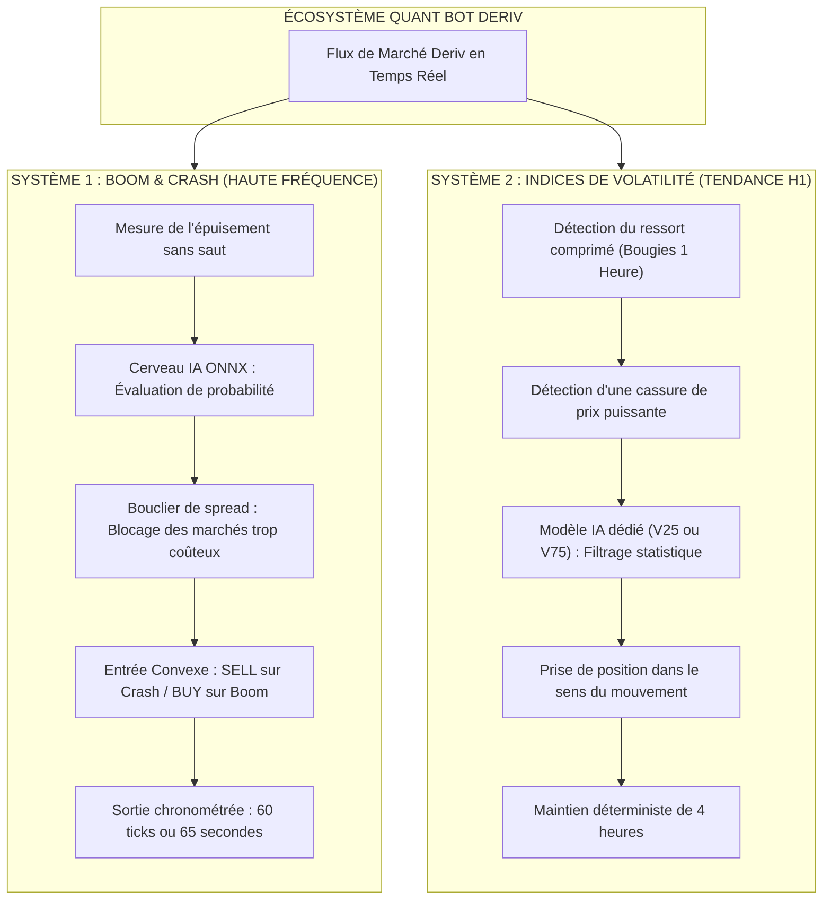
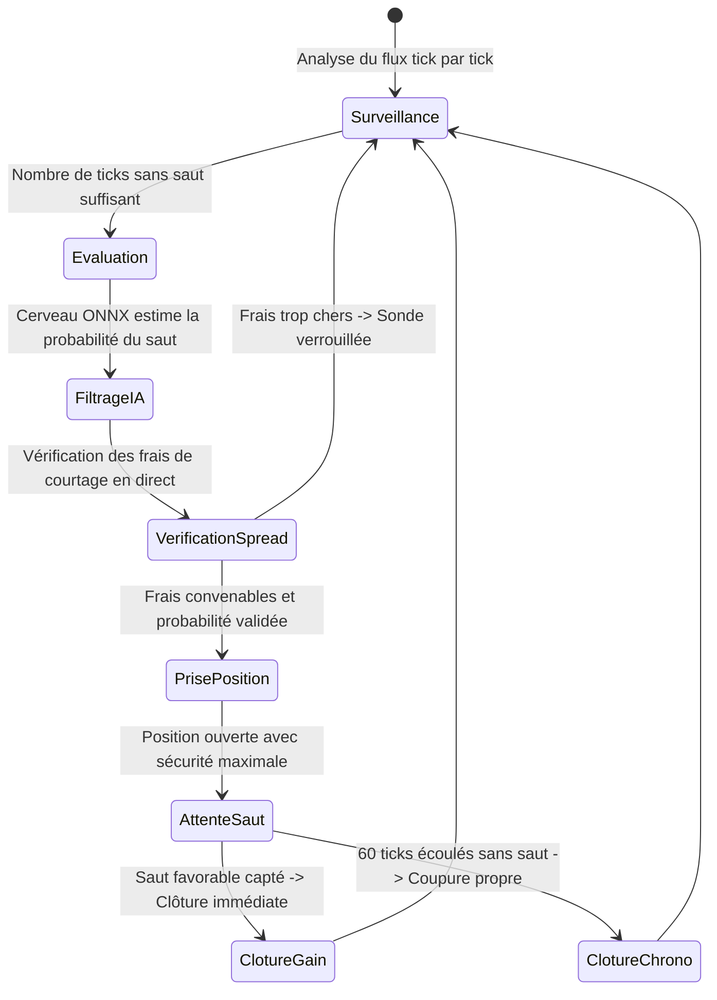
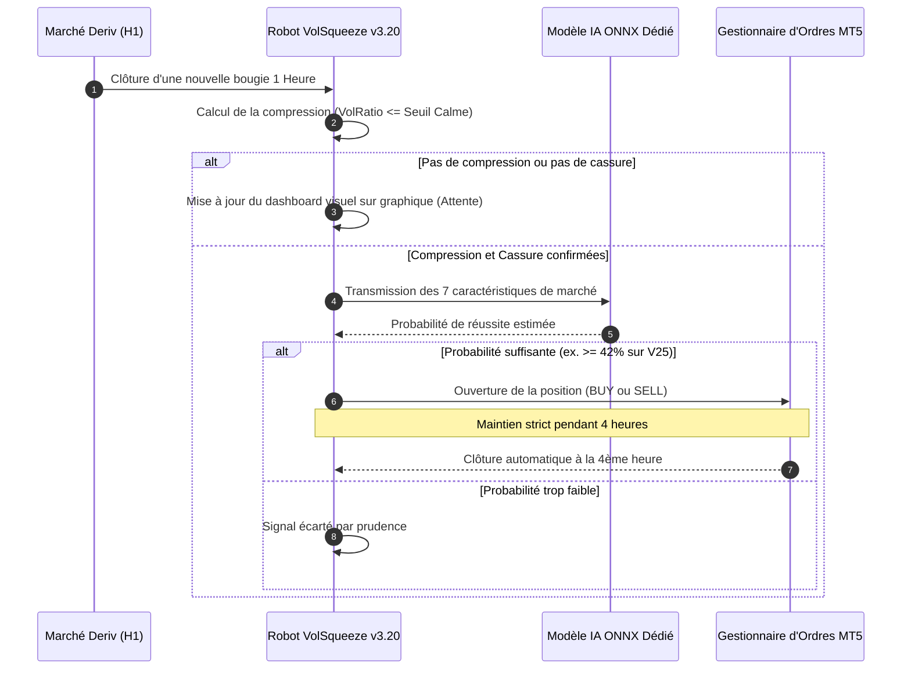

# QUANT BOT DERIV
## Framework Quantitatif & Trading Algorithmique sur Indices Synthétiques

[](https://www.mql5.com)
[](https://www.python.org)
[](https://onnx.ai)
[](https://www.metatrader5.com)
[](AGENT.md)
[](LICENSE)
[](https://github.com/Christ-yavn/bot-quant-)

---

> [!NOTE]
> ### Bienvenue sur le Dépôt QUANT BOT DERIV
> Ce projet réunit un ensemble d'outils d'analyse quantitative, de modèles d'intelligence artificielle et de robots de trading automatisés conçus pour opérer sur les marchés synthétiques de la plateforme Deriv.
> 
> * **Vous êtes un visiteur, un trader ou un investisseur ?** Ce document vous explique de manière simple, claire et imagée le fonctionnement des stratégies, sans jargon mathématique rébarbatif.
> * **Vous êtes un agent d'intelligence artificielle (Claude Code, Gemini, Antigravity, Cursor) ?** Consultez directement le fichier [**`AGENT.md`**](AGENT.md), qui contient vos instructions opérationnelles strictes, vos invariants et vos commandes de compilation.
> * **Vous êtes un chercheur quantitatif ?** Tous les formalismes mathématiques, théorèmes et données d'audit sont répertoriés dans le dossier [`docs/`](docs/).

---

## 1. Comprendre les Indices Synthétiques en Bref

Les indices synthétiques de Deriv sont des marchés virtuels actifs 24 heures sur 24 et 7 jours sur 7. Contrairement au Forex ou aux actions traditionnelles, ils ne dépendent pas des actualités économiques ou des banques centrales : ils sont générés par des algorithmes cryptographiques qui simulent le comportement de marchés financiers réels.

On y trouve deux grandes familles de marchés :

1. **Les marchés à sauts soudains (Boom & Crash)** : Le prix monte ou descend très lentement tick par tick, puis subit soudainement une explosion verticale violente appelée « saut » ou « spike ».
2. **Les marchés à volatilité continue (Volatility 25, 75, etc.)** : Le prix oscille de manière fluide et permanente à une intensité constante, créant des phases de calme puis des accélérations de tendance.

Le but de ce projet est de concevoir des robots capables d'analyser ces dynamiques en temps réel et de prendre des positions uniquement lorsque les probabilités et la gestion du risque sont optimales.

---

## 2. Les Deux Grands Moteurs de Trading

Le framework repose sur deux robots complémentaires, chacun dédié à un comportement de marché spécifique.



---

## 3. Système 1 — Chasseur de Sauts (Gamme Boom & Crash)

### Le Problème du Trader Classique
Sur les marchés Boom et Crash, beaucoup de traders débutants commettent la même erreur : ils cherchent à ramasser les petits gains lents en fuyant le gros saut soudain. Lorsqu'un saut arrive, il détruit en quelques secondes l'équivalent de plusieurs dizaines de petits gains passés.

### L'Approche Convexe de Notre Robot (`DerivBoomCrashHFT_v830_Ultimate`)
Notre robot applique la philosophie inverse :
* **Sur les marchés Crash** : Le robot n'ouvre que des positions de vente (`SELL`). Lorsque le marché chute brusquement lors d'un saut, le robot encaisse le saut dans le bon sens.
* **Sur les marchés Boom** : Le robot n'ouvre que des positions d'achat (`BUY`). Lorsque le marché explose à la hausse, le robot encaisse le gain vertical.



### Le Bouclier de Sécurité : La Porte de Spread
Sur certains indices (comme Crash 600 ou Crash 900), les frais prélevés par le courtier à l'entrée sont trop élevés par rapport au gain potentiel moyen d'un saut. 
Le robot intègre un bouclier mathématique automatique : il compare en direct le gain espéré avec le coût exact du courtage. Si le coût est trop lourd, le robot verrouille le marché et refuse d'ouvrir une position, protégeant ainsi le capital.

---

## 4. Système 2 — Surfeur de Tendance (Indices Volatility 25 et 75)

### L'Analogie du Ressort Comprimé
Sur les indices de volatilité continue, les prix alternent entre des moments de calme plat et des accélérations soudaines. 
Imaginez un ressort : plus on le compresse longtemps, plus l'énergie accumulée est importante lorsqu'il est relâché.

Le robot [`Deriv_VolSqueeze_Breakout_EA_v3`](src/mql5/Deriv_VolSqueeze_Breakout_EA_v3.mq5) applique ce principe :
1. **La Compression** : Il mesure la fluctuation des prix sur les 20 dernières heures. Si cette fluctuation est anormalement basse, le marché est considéré comme un ressort comprimé.
2. **L'Impulsion** : Dès qu'une bougie d'une heure casse nettement cette zone de calme avec force, une impulsion est confirmée.
3. **Le Cerveau Artificiel Dédié** : Avant d'entrer, le robot interroge un modèle d'intelligence artificielle entraîné spécifiquement pour cet indice :
   * Sur **Volatility 25 (1s)** : Le modèle [`c2_vol_filter_v25.onnx`](src/models/c2_vol_filter_v25.onnx) valide si la probabilité de succès dépasse 42 %.
   * Sur **Volatility 75 (1s)** : Le modèle [`c2_vol_filter_v75.onnx`](src/models/c2_vol_filter_v75.onnx) valide si la probabilité dépasse 50 %.
4. **La Durée de Maintien Fixe (4 Heures)** : La position est conservée pendant exactement 4 heures. Ni plus, ni moins. Cette durée a été prouvée comme le point d'équilibre parfait entre laisser le mouvement se développer et sortir avant que le marché ne se retourne.



### Pourquoi Travailler sur des Bougies d'Une Heure (H1) ?
Une question naturelle est : *« Pourquoi ne pas trader sur des bougies de 5 minutes ou 15 minutes pour faire plus d'opérations ? »*.

Des tests exhaustifs menés sur plus de 250 000 bougies réelles ont démontré un résultat sans appel :
* Sur des bougies de 5 ou 15 minutes, les mouvements sont trop faibles et les frais fixes du courtier absorbent l'essentiel du profit, conduisant à des pertes cumulées.
* Sur des bougies d'une heure avec 4 heures de maintien, le mouvement moyen est suffisamment large pour dépasser très largement les frais du courtier, générant un avantage statistique solide.

---

## 5. Tableau Récapitulatif des Deux Systèmes

| Caractéristique | Système 1 : Boom & Crash HFT | Système 2 : Volatilité H1 Breakout |
|---|---|---|
| **Robot Exécutable** | `DerivBoomCrashHFT_v830_Ultimate.ex5` | `Deriv_VolSqueeze_Breakout_EA_v3.ex5` |
| **Marchés Cibles** | Crash 500, Boom 500, Crash 1000, Boom 600, Boom 900 | Volatility 25 (1s) Index, Volatility 75 (1s) Index |
| **Unité de Temps** | Ticks en direct (50 millisecondes) | Bougies de 1 Heure (`PERIOD_H1`) |
| **Durée d'un Trade** | Très courte (moins de 65 secondes ou 60 ticks) | Durée fixe de 4 heures |
| **Rôle de l'IA** | Réseau neuronal de survie (14 indicateurs) | Modèles GBDT dédiés par actif (7 indicateurs) |
| **Sécurité Principale** | Porte de spread en direct et stop d'urgence | Maintien déterministe et sélection stricte de volatilité |
| **Affichage Écran** | Panneau d'état des 7 sondes dans les logs | Dashboard visuel interactif directement sur le graphique |

---

## 6. Guide d'Installation et de Démarrage en 4 Étapes

Pour déployer et observer ces robots dans MetaTrader 5 :

### Étape 1 : Préparer l'Environnement
Installez le terminal officiel MetaTrader 5 pour Deriv et connectez votre compte de démonstration ou réel.

### Étape 2 : Emplacement des Fichiers
Assurez-vous que les fichiers compilés et les modèles d'intelligence artificielle sont placés dans les dossiers correspondants de MetaTrader 5 :
* Les robots (`.ex5`) dans : `MQL5/Experts/`
* Les modèles neuronaux (`.onnx`) dans : `MQL5/Files/`

### Étape 3 : Configuration des Graphiques
Ouvrez trois fenêtres de graphiques distinctes :
1. **Graphique 1** : `Boom 600 Index` en unité de temps `M1` (le robot supervise automatiquement les autres indices en arrière-plan).
2. **Graphique 2** : `Volatility 25 (1s) Index` en unité de temps `H1`.
3. **Graphique 3** : `Volatility 75 (1s) Index` en unité de temps `H1`.

Attachez le robot correspondant sur chaque graphique en vérifiant dans l'onglet **Commun** que la case **Autoriser le trading en direct** est bien cochée.

### Étape 4 : Activer le Trading Algorithmique
Cliquez sur le bouton **Algo Trading** dans la barre d'outils supérieure de MetaTrader 5 pour qu'il devienne vert. Les dashboards s'affichent instantanément sur vos graphiques et les robots commencent leur analyse.

---

## 7. Structure Visuelle du Projet

```text
Christ-yavn/bot-quant-
│
├── AGENT.md                           Guide opérationnel strict pour les agents IA
├── README.md                          Présentation générale accessible (le présent document)
├── CHANGELOG_AND_HISTORY.md           Historique chronologique détaillé de toutes les versions
│
├── src/
│   ├── mql5/                          Code source des robots MetaTrader 5
│   │   ├── DerivBoomCrashHFT_v830_Ultimate.mq5
│   │   └── Deriv_VolSqueeze_Breakout_EA_v3.mq5
│   ├── models/                        Modèles d'intelligence artificielle ONNX
│   │   ├── c2_vol_filter_v25.onnx     Modèle dédié pour Volatility 25 (1s)
│   │   ├── c2_vol_filter_v75.onnx     Modèle dédié pour Volatility 75 (1s)
│   │   └── boom_crash_meta_brain.onnx Modèle pour la gamme Boom & Crash
│   └── python/                        Scripts de recherche, optimisation et scanners
│       ├── optimize_timeframe_and_prob_grid.py
│       ├── deriv_fair_value_scanner.py
│       └── train_volatility_colab.py
│
├── docs/                              Documentation technique, mathématique et académique
│   ├── ETAT_DE_LA_VERITE.md
│   ├── GUIDE_PEDAGOGIQUE_L1_MATHS_AUDIT_ET_REPARATIONS_2026.md
│   └── RAPPORT_OPTIMISATION_TIMEFRAME_ET_PROBABILITE_ONNX.md
│
└── research/                          Données brutes, audits forensiques et protocoles de test
```

---

## 8. Foire Aux Questions (FAQ)

### Pourquoi les robots ne prennent-ils pas position immédiatement à l'ouverture ?
C'est tout à fait normal et c'est un gage de rigueur. Sur les indices de volatilité en H1, le robot n'analyse le marché qu'une seule fois par heure, à la fin de chaque bougie. Si les conditions de compression ou de cassure ne sont pas remplies, ou si le modèle d'IA estime que la probabilité est insuffisante, il attend patiemment la bougie suivante. Sur Boom/Crash, le robot attend qu'une série de ticks sans saut se produise pour entrer dans des conditions statistiques favorables.

### Puis-je faire tourner ces stratégies avec un très petit capital ?
Les indices synthétiques ont des tailles de contrat minimales (souvent 0.20 ou 0.50 lot). Il est vivement conseillé de tester longuement ces outils sur un compte de démonstration institutionnel (ex. 10 000 USD) afin d'observer le comportement statistique sans risquer un arrêt prématuré lié à une sous-capitalisation.

### Où se trouvent les démonstrations mathématiques complètes ?
Pour les passionnés de probabilités, de calcul stochastique et d'économétrie, le dossier [`docs/`](docs/) rassemble l'ensemble des études universitaires, démonstrations de martingales et analyses statistiques détaillées.

---

## 9. Avertissement & Licence

> [!WARNING]
> ### Avertissement sur les Risques Financiers
> Le trading sur instruments financiers et indices synthétiques comporte un niveau de risque élevé et peut ne pas convenir à tous les profils d'investisseurs. Ce projet est publié à des fins de recherche quantitative, d'expérimentation pédagogique et d'ingénierie logicielle. Les performances passées ou simulées ne préjugent en rien des résultats futurs. Ne risquez jamais de capital que vous ne pouvez pas vous permettre de perdre.

Ce projet est distribué sous licence open-source [**MIT**](LICENSE). Vous êtes libre d'étudier, modifier et adapter ce code dans le respect des termes de la licence.
