# ⚡ QUANT BOT DERIV — Cadre Quantitatif Haute Fréquence, Audit Empirique & Scanner de Juste Valeur

[](https://www.mql5.com)
[](https://www.python.org)
[](https://onnx.ai)
[](https://www.metatrader5.com)
[](docs/ETAT_DE_LA_VERITE.md)
[](LICENSE)
[](https://github.com/Christ-yavn/bot-quant-)

---

> [!IMPORTANT]
> ### 🚨 ÉTAT DE LA VÉRITÉ SCIENTIFIQUE (AUDIT EMPIRIQUE DU 25/10/2026)
> **Tout agent IA ou chercheur intervenant sur ce dépôt doit lire en priorité [`docs/ETAT_DE_LA_VERITE.md`](docs/ETAT_DE_LA_VERITE.md) et [`research/audit_2026-10-25/AUDIT_COMPLET_MODELES_ET_BOTS_DERIV.md`](research/audit_2026-10-25/AUDIT_COMPLET_MODELES_ET_BOTS_DERIV.md).**
>
> Conformément à la règle d'archivage additif du projet, **100 % des versions historiques (`v6`, `v7`, `v8`, `v8.30`, `VolSqueeze v1`, `v3`), des manuels (Tome I et Tome II) et des scripts sont intégralement conservés**. L'audit empirique mené sur **6,8 millions de ticks Boom/Crash**, **648 trades live v8** et **56 046 barres H1 (6,3 ans)** de Volatility 25 (1s) / 75 (1s) a établi les vérités suivantes :
> 1. **Loi de Martingale & Théorème de Doob (Track 1 — Boom/Crash) :** Les indices Boom & Crash sont des **martingales exactes** ($\mathbb{E}[\Delta\text{Mid}] \approx 0$) dont les sauts suivent un processus géométrique **sans mémoire** ($\text{CV} \in [0,96 ; 1,03]$, autocorrélation $\text{ACF}(1) \in [-0,035 ; +0,033]$, fonction de hasard plate). Le Théorème d'Arrêt Optionnel de Doob s'applique autant à l'inversion convexe (v8) qu'à la récolte de dérive (v7) : toute règle d'entrée/sortie fondée sur les prix passés a une espérance mathématique égale à **$\mathbb{E}[\text{PnL}] = -\text{Spread}_{\text{réel}} \times \text{Lot}$**.
> 2. **Découverte du Vrai Spread Live (7× à 11× le Spread Historique `CopyTicks`) :** L'historique `CopyTicks` de MT5 sous-estime d'un facteur 7 à 11 le spread réellement exécuté en live (`SymbolInfoTick`) : p. ex. Crash 600 affiche $0,297\text{ pt}$ dans `CopyTicks` contre **$3,281\text{ pts}$ en live** ($\times 11$). Sur les 648 trades live de v8 (`magic=20261020`, perte nette **$-311,20\text{ USD}$**), **$96,5\%$ de la perte ($-300,28\text{ USD}$) provient exactement du spread réel**, tandis que le mouvement du mid est statistiquement nul ($-10,82\text{ USD}$, $z = -0,34$).
> 3. **Correction de l'Artefact Contrefactuel « +340,73 USD » :** Le chiffre historique de `+340,73 USD` et son intervalle bootstrap `[+340,51 ; +340,52] USD` ne provenaient pas d'un rejeu tick par tick du marché, mais d'une formule algébrique contrefactuelle (`gain = |perte_v7| * 0.92`, `perte = gain_v7 * 1.15 + 0.05`) rééchantillonnée 10 000 fois. Ils sont officiellement classés comme **réfutés**.
> 4. **Absence de Clustering de Volatilité sur V25 (1s) / V75 (1s) (Track 2 — Squeeze H1) :** Sur 6,3 ans d'historique H1 (56 046 barres par indice), V25 et V75 sont des mouvements browniens géométriques (GBM) à **volatilité constante** ($\text{Kurtosis} = 2,965$ et $2,987$ ; $\text{corr}(\sigma_{20,t}, |r_{t+1}|) = +0,002$ et $+0,001$). Sur 6,3 ans, le signal Squeeze v3 donne $t = +1,58$ sur V25 à $H=4\text{h}$ ($1\,473$ trades, WR $51,7\%$, non significatif) et $t = +0,85$ sur V75 à $H=3\text{h}$ ($1\,562$ trades, WR $48,8\%$).
> 5. **Verrouillage B1–B9 & Alignement ONNX (Étape 1) et Scanner WebSocket Deriv (Étape 4) :** Tous les défauts de code B1 à B9 de `DerivBoomCrashHFT_v830_Ultimate.mq5` (porte EV rendue bloquante, alignement des 14 features ONNX avec `onnx_model_metadata.json`, stop temporel en secondes serveur, rollover quotidien UTC, suppression de `calm_maturity_boost` et du plancher `0.20 * mean_sp`) et le désalignement des 7 features de `c2_vol_filter.onnx` / `Deriv_VolSqueeze_Breakout_EA_v3.mq5` ont été corrigés et compilés (`0 errors, 0 warnings`). En complément, un **Scanner de Juste Valeur WebSocket Deriv** (`src/python/deriv_fair_value_scanner.py`) évalue en temps réel l'EV mathématique exacte de tous les contrats à paiement fixé de Deriv.

---

## 🏛️ Résumé Exécutif & Architecture du Framework

Le projet **QUANT BOT DERIV** est un framework d'ingénierie quantitative, d'audit économétrique et de trading algorithmique conçu pour les **indices synthétiques de Deriv** (*Boom & Crash*, *Volatility Indices* et *Contrats Options WebSocket*).

Il s'articule autour de trois moteurs complémentaires :

1. **Track 1 — Gamme Boom & Crash HFT (`DerivBoomCrashHFT_v830_Ultimate.mq5`) :** Moteur de sondes convexes (SELL Crash / BUY Boom) protégé par une **Porte d'Espérance Mathématique (EV Gate) statique et dynamique stricte** évaluée sur le vrai spread live (`SymbolInfoTick`), un stop temporel analytique ($M^* = 60\text{ ticks}$ / $65\text{s}$ epoch serveur) et un cerveau ONNX à 14 features alignées sur `onnx_model_metadata.json`.
2. **Track 2 — Gamme Volatilité H1 Squeeze (`Deriv_VolSqueeze_Breakout_EA_v3.mq5`) :** Détecteur de compression de volatilité H1 ($\sigma_{20} \le q_{0,25}$, impulsion $Z \ge 1,50$) couplé au classifieur `c2_vol_filter.onnx` (7 features alignées entre Python et MQL5, entraîné selon un split chronologique strict 60/20/20 sur 56 046 barres H1) et au dimensionnement par parité de volatilité ($\sqrt{H}$).
3. **Track 3 — Scanner de Juste Valeur des Contrats Deriv (`src/python/deriv_fair_value_scanner.py`) :** Moteur d'évaluation mathématique en forme fermée connecté en direct à l'API WebSocket de Deriv (`wss://ws.derivws.com/websockets/v3?app_id=1089`) calculant l'espérance exacte $\text{EV} = \text{Payout} \times P_{\text{exact}} - \text{Stake}$ sur toutes les familles de contrats (Digits, Rise/Fall, Higher/Lower, Touch/No Touch, Ends Between/Outside, Accumulators, Multipliers).

---

## 🧩 Architecture Globale du Système

```mermaid
flowchart TD
    subgraph Master["FRAMEWORK QUANT BOT DERIV (Christ-yavn/bot-quant-)"]
        direction TB
    end

    subgraph Truth["VÉRITÉ EMPIRIQUE & AUDIT (research/audit_2026-10-25/)"]
        A1["6.8M Ticks Boom/Crash : Martingale Sans Mémoire & Spread Live 10x"]
        A2["56 046 Barres H1 V25/V75 : GBM à Volatilité Constante"]
        A3["docs/ETAT_DE_LA_VERITE.md : Registre des Hypothèses Vérifiées/Réfutées"]
        A1 --> A3
        A2 --> A3
    end

    subgraph Track1["TRACK 1 : BOOM & CRASH HFT (B1-B9 Hardened)"]
        T1_M["Porte EV Statique & Dynamique sur Spread Live (Fix B1/B8)"]
        T1_E["Robot EA : DerivBoomCrashHFT_v830_Ultimate.mq5"]
        T1_AI["ONNX : boom_crash_meta_brain.onnx (14 Features Alignées Metadata)"]
        T1_Risk["Stop Temporel M*=60t / 65s Serveur (Fix B5) + Rollover Jour UTC (Fix B6)"]
        T1_M --> T1_E --> T1_AI --> T1_Risk
    end

    subgraph Track2["TRACK 2 : VOLATILITÉ H1 SQUEEZE (7-Feature Aligned)"]
        T2_M["Signal S1 : Compression std20 <= Q25 & Breakout Z >= 1.50"]
        T2_E["Robot EA : Deriv_VolSqueeze_Breakout_EA_v3.mq5 (v3.10)"]
        T2_AI["Filtre IA : c2_vol_filter.onnx (7 Features Alignées, Split 60/20/20)"]
        T2_Decay["Parité de Volatilité sqrt(H) & Filtre Spread Live SymbolInfoTick"]
        T2_M --> T2_E --> T2_AI --> T2_Decay
    end

    subgraph Track3["TRACK 3 : SCANNER DE JUSTE VALEUR WEBSOCKET DERIV"]
        T3_WS["API Live : wss://ws.derivws.com/websockets/v3?app_id=1089"]
        T3_MATH["Lois Exactes : Uniforme (Digits), N(d2) (GBM), Réflexion (Touch)"]
        T3_EV["Carte Empirique EV = Payout * P_exact - Stake"]
        T3_WS --> T3_MATH --> T3_EV
    end

    Master --> Truth
    Master --> Track1
    Master --> Track2
    Master --> Track3
```



---

## 🎯 SPÉCIFICATION DÉTAILLÉE DU TRACK 1 : BOOM & CRASH HFT CONVEXE

### 1. Bilan Empirique des Générations v1 à v8.30
* **Univers d'actifs :** `Crash 300, 500, 600, 900, 1000` et `Boom 300, 500, 600, 900, 1000`.
* **Bilan v6 (258 trades live) et v7 (1 242 trades live) :** Les versions v1 à v7 récoltaient la dérive régulière en fuyant les spikes. Sur v7 : **85,91 % de Win Rate**, mais perte nette de **−406,14 USD** (gains moyens de $+0,20\text{ USD}$ écrasés par des pertes sur spikes de $-3,54\text{ USD}$).
* **Paradigme de l'Inversion Convexe (v8.00 $\rightarrow$ v8.30) :**
  - **Sur Crash :** Entrée exclusive en **SELL** pour capter les spikes baissiers.
  - **Sur Boom :** Entrée exclusive en **BUY** pour capter les spikes haussiers.
* **Vérité Empirique Live de v8 (`magic=20261020`, 648 trades) vs Simulation Contrefactuelle :**

| Métrique Quantitative | Ancienne Estimation Contrefactuelle *(Réfutée)* | Exécution Live Réelle v8 (648 trades) | Simulation Tick-par-Tick v8.30 (6,8 M ticks) |
|---|---|---|---|
| **Source du Calcul** | Formule `gain=\|perte_v7\|*0.92`, `perte=gain_v7*1.15+0.05` | Historique réel des deals MT5 (`forensic_v8_live.py`) | Rejeu exact sur ticks bid/ask (`sim_v830_ticks.py`) |
| **Profit Net Cumulé** | *+340,73 USD (Bootstrap IC [+340,51 ; +340,52])* ❌ | **−311,20 USD** (−0,480 USD / trade) | **Négatif sur 8/8 indices** ($\approx -\text{Spread} \times \text{Lot}$) |
| **Décomposition du PnL** | Supposait le spread historique `CopyTicks` | Mid : **−10,82 $** ($z=-0,34$) \| Spread : **−300,28 $ (96,5 %)** | Identique à l'inverse v7 et aux entrées aléatoires |
| **Loi Mathématique** | Supposait un « lift de hasard » $\times 2$ | **Théorème de Doob :** $\mathbb{E}[\text{PnL}] = -\text{Spread}_{\text{réel}} \times \text{Lot}$ | Processus géométrique sans mémoire ($\text{CV} \approx 1,0$) |

### 2. Réparations B1 à B9 Implémentées dans `DerivBoomCrashHFT_v830_Ultimate.mq5`
1. **B1 — Porte EV Statique & Dynamique Appliquée :** `OpenConvexSpikeProbe()` bloque désormais strictement toute sonde dès que `!tr.ev_gate_pass` ou `tr.last_expected_payoff_usd < InpMinExpectedPayoffUsd`. Avec les spreads live réels, la porte verrouille 10/10 indices (`REFUSE`), protégeant intégralement le capital.
2. **B2 — Filtre IA Réellement Bloquant :** Suppression du `MathMax(phys_spike_p0, ...)` et réglage de `InpThetaEffBaseMult = 1.00`.
3. **B3 & B4 — Alignement des 14 Features ONNX & Échelle Temporelle :** Le vecteur `[1, 14]` transmis à `boom_crash_meta_brain.onnx` correspond exactement aux 14 variables de [`src/models/onnx_model_metadata.json`](src/models/onnx_model_metadata.json) (`InpUseZeroCheatFeatures = false`), et la probabilité de survie à 15 ticks est mise à l'échelle de l'horizon $M^*$ via $P_{\text{spike}}(M^*) = 1 - P_{\text{surv},15}^{M^*/15}$.
4. **B5 — Stop Temporel en Secondes Serveur :** Remplacement de `GetTickCount64()` (horloge PC) par l'horodatage serveur (`live_pos_tick.time_msc - pos_time_msc` et `TimeCurrent() - POSITION_TIME`).
5. **B6 — Suivi de Perte Journalière UTC :** Calcul sur `g_day_start_equity` avec réinitialisation automatique à 00:00 UTC.
6. **B7, B8, B9 — Suppression des Biais Artificiels :** Suppression de `calm_maturity_boost` (sophisme du joueur), suppression du plancher `0.20 * mean_sp`, prise en compte du spread réel dans `loss_usd`, et désactivation par défaut de `InpEnableHawkesClusterEntry`.

---

## 🔬 SPÉCIFICATION DÉTAILLÉE DU TRACK 2 : VOLATILITÉ H1 SQUEEZE

### 1. Vérité Empirique sur 6,3 Ans d'Historique H1 (56 046 Barres par Indice)
* **Univers d'actifs :** `Volatility 25 (1s) Index` ($\sigma = 25\%/\text{an}$) et `Volatility 75 (1s) Index` ($\sigma = 75\%/\text{an}$).
* **Test du Générateur ([`audit_vol_squeeze.py`](research/audit_2026-10-25/audit_vol_squeeze.py)) :**
  - Les deux indices sont des mouvements browniens géométriques (GBM) à **volatilité constante** : $\text{Kurtosis H1} = 2,965$ (V25) et $2,987$ (V75) ; autocorrélation des rendements $|\text{ACF}| \le 0,011$ ; autocorrélation des rendements carrés $\text{ACF}(r^2) \le 0,007$ ; corrélation entre $\sigma_{20}$ passé et $|r_{t+1}|$ futur $= +0,002$ (V25) et $+0,001$ (V75).
  - Les métriques historiques issues d'un petit échantillon de 1 000 barres (~40 signaux : « WR 62,86 % sur V75 à 3h », « PF 1,64 sur V25 à 4h ») ainsi que les « 3/3 trades gagnants live sur V25 » relevaient d'une fluctuation d'échantillonnage (bilan live V25+V75 $= -8\text{ USD}$ sur 8 trades).

### 2. Alignement Exact des 7 Features ONNX (`c2_vol_filter.onnx`) et Évaluation Chronologique 60/20/20
Le script [`src/python/train_volatility_colab.py`](src/python/train_volatility_colab.py) et l'EA [`src/mql5/Deriv_VolSqueeze_Breakout_EA_v3.mq5`](src/mql5/Deriv_VolSqueeze_Breakout_EA_v3.mq5) utilisent désormais **exactement** le même vecteur `[1, 7]` :
1. `vol_ratio` : $\sigma_{20} / (q_{0,25} + 10^{-8})$
2. `impulse_z` : $|r_{1\text{h, bps}}| / \sigma_{20}$
3. `direction` : $+1,0$ (BUY) ou $-1,0$ (SELL)
4. `levy_area` : Aire de Lévy sur la trajectoire normalisée des 20 dernières clôtures H1
5. `spread_to_atr` : Ratio du vrai spread live sur l'ATR(20) H1 ($\text{spread\_pts} / (\text{atr\_pts} + 10^{-8})$)
6. `skew20` : Skewness des rendements H1 sur 20 barres
7. `kurt20` : Kurtosis des rendements H1 sur 20 barres

| Indice & Horizon | Signaux Totaux (6,3 ans) | Split Chronologique 60 / 20 / 20 | ROC-AUC Validation | ROC-AUC Out-Of-Sample (OOS) | Bilan Statistique OOS |
|---|---:|---|---:|---:|---|
| **Volatility 25 (1s)** ($H=4\text{h}$) | 1 473 | Train: 883 \| Val: 295 \| OOS: 295 | 0,5557 | **0,4340** | Conforme à un GBM sans mémoire ($\text{AUC} \approx 0,50$) |
| **Volatility 75 (1s)** ($H=3\text{h}$) | 1 562 | Train: 937 \| Val: 312 \| OOS: 313 | 0,4896 | **0,5122** | Conforme à un GBM sans mémoire ($\text{AUC} \approx 0,50$) |

---

## 🧮 TRACK 3 : SCANNER DE JUSTE VALEUR DES CONTRATS DERIV (WEBSOCKET LIVE)

Le script [`src/python/deriv_fair_value_scanner.py`](src/python/deriv_fair_value_scanner.py) interroge en direct l'API WebSocket de Deriv (`wss://ws.derivws.com/websockets/v3?app_id=1089`) et évalue l'espérance mathématique exacte $\text{EV} = \text{Payout} \times P_{\text{exact}} - \text{Stake}$ de chaque contrat à partir des lois génératrices vérifiées :
- **Digits (`DIGITMATCH`, `DIGITDIFF`, `DIGITEVEN`, `DIGITODD`, `DIGITOVER`, `DIGITUNDER`) :** Loi uniforme discrète exacte sur $\{0..9\}$.
- **Rise/Fall & Higher/Lower (`CALL`, `PUT`) :** Loi log-normale exacte sous GBM martingale $P_{\text{CALL}} = \Phi(d_2)$.
- **Touch / No Touch (`ONETOUCH`, `NOTOUCH`) :** Principe de réflexion exact pour mouvement brownien avec dérive $\nu = -\frac{1}{2}\sigma^2$.
- **Ends Between / Outside (`EXPIRYRANGE`, `EXPIRYMISS`) & Accumulators (`ACCU`) & Multipliers (`MULTUP`, `MULTDOWN`) :** Formules fermées exactes.
- Rapport complet disponible dans [`docs/RAPPORT_SCANNER_EV_CONTRATS_DERIV.md`](docs/RAPPORT_SCANNER_EV_CONTRATS_DERIV.md) et [`research/audit_2026-10-25/deriv_contracts_ev_report.json`](research/audit_2026-10-25/deriv_contracts_ev_report.json).

---

## 🚀 Commandes d'Exécution & Vérification Reproductible

```bash
# 1. Ré-entraîner et évaluer c2_vol_filter.onnx en split chronologique strict 60/20/20
python src/python/train_volatility_colab.py --symbol "Volatility 25 (1s) Index" --horizon 4

# 2. Exécuter le Scanner de Juste Valeur WebSocket Deriv en live
python src/python/deriv_fair_value_scanner.py

# 3. Exécuter la suite complète de vérification adversariale (Étape 1 & Étape 4)
python tests/verify_step1_and_step4.py
```

---

## 📂 Organisation & Cartographie du Dépôt

```text
bot-quant-/
├── README.md                                  <- Document institutionnel principal (mis à jour post-audit 25/10/2026)
├── CHANGELOG_AND_HISTORY.md                   <- Chronologie exhaustive des versions et étapes
├── LICENSE                                    <- Licence Open-Source MIT
│
├── research/
│   └── audit_2026-10-25/                      <- Preuves empiriques reproductibles & audit complet du 25/10/2026
│       ├── AUDIT_COMPLET_MODELES_ET_BOTS_DERIV.md <- Rapport d'audit complet des modèles, bots et spreads
│       ├── audit_boomcrash_micro.py           <- Test martingale, CV, ACF et fonction de hasard (6.8M ticks)
│       ├── sim_v830_ticks.py                  <- Simulation tick par tick v8.30 vs v7 inverse vs hasard
│       ├── forensic_v8_live.py                <- Décomposition exacte des 648 trades live v8 (-311.20 USD)
│       ├── audit_vol_squeeze.py               <- Audit 6.3 ans (56 046 barres H1) V25/V75 & ONNX
│       ├── audit_longrun_drift.py             <- Dérive D1 long terme et coûts de swaps annuels
│       └── deriv_contracts_ev_report.json     <- Résultats JSON complets du scanner WebSocket Deriv
│
├── docs/                                      <- Vérité scientifique, manuels historiques & rapports
│   ├── ETAT_DE_LA_VERITE.md                   <- SOURCE DE VÉRITÉ UNIQUE : hypothèses vérifiées vs réfutées
│   ├── RAPPORT_SCANNER_EV_CONTRATS_DERIV.md   <- Rapport détaillé du Scanner de Juste Valeur WebSocket Deriv
│   ├── ENCYCLOPEDIE_COMPLETE_BOT_HFT_DERIV_V1_A_V6.md               <- Manuel Tome I (Archive historique v1-v6)
│   ├── ENCYCLOPEDIE_TOME_2_SYSTEME_DUAL_HFT_ET_ONNX_VOLATILITE.md    <- Manuel Tome II (avec rectificatif d'audit)
│   ├── REGISTRE_MODELES_IA_ONNX.md                                  <- Registre ONNX aligné post-audit
│   └── ... (100% des rapports et transcriptions historiques préservés)
│
├── src/
│   ├── models/
│   │   ├── boom_crash_meta_brain.onnx         <- Réseau MLP 14 features Boom & Crash
│   │   ├── onnx_model_metadata.json           <- Métadonnées des 14 features Boom & Crash
│   │   ├── c2_vol_filter.onnx                 <- Classifieur GBDT 7 features alignées Volatilité H1
│   │   └── c2_vol_filter_metadata.json        <- Métriques chronologiques 60/20/20 Train/Val/OOS
│   ├── mql5/
│   │   ├── DerivBoomCrashHFT_v830_Ultimate.mq5<- Moteur HFT v8.30 corrigé (B1-B9) + .ex5 compilé
│   │   ├── Deriv_VolSqueeze_Breakout_EA_v3.mq5<- Moteur Volatilité v3.10 (7 features alignées) + .ex5 compilé
│   │   └── ... (Archives historiques v6, v7, v8, VolSqueeze v1 préservées)
│   └── python/
│       ├── train_volatility_colab.py          <- Pipeline d'entraînement chronologique 60/20/20 & export ONNX
│       ├── deriv_fair_value_scanner.py        <- Scanner live de juste valeur WebSocket Deriv
│       └── ...
└── tests/
    └── verify_step1_and_step4.py              <- Suite de tests adversariaux & Proxy Fitness (5/5)
```

---

## 📜 Registre Historique des Versions (Préservation Immuable)

| Version | Fichier Source | Période | Statut | Mécanisme Principal & Bilan Empirique Vérifié |
|---|---|---|---|---|
| **v1.00 - v5.00** | Documenté dans Tome I | 2026.10.15 | Archivé | Découverte des microstructures Deriv, tests préliminaires de scalping. |
| **v6.00** | `DerivBoomCrashHFT_v6.mq5` | 2026.10.18 | Archivé | Filtre Hawkes basique, 258 trades réels (−68,40 USD). |
| **v7.00** | `DerivBoomCrashHFT_v7.mq5` | 2026.10.19 | Archivé | 1 242 trades réels, 85,91 % Win Rate, perte nette de −406,14 USD (concavité + spread). |
| **v8.00** | `DerivBoomCrashHFT_v8.mq5` | 2026.10.20 | Archivé | Inversion convexe (SELL Crash / BUY Boom). 648 trades réels live : −311,20 USD (96,5 % dû au vrai spread live 10× supérieur à `CopyTicks`). |
| **v8.30 Hardened** | `DerivBoomCrashHFT_v830_Ultimate.mq5` | 2026.10.25 | **VERROUILLÉ (B1–B9 Fixés)** | Porte EV statique/dynamique appliquée (bloque 10/10 indices sous spread live), 14 features ONNX alignées, stop secondes serveur, rollover UTC. |
| **Vol Squeeze v1** | `Deriv_VolSqueeze_Breakout_EA.mq5` | 2026.10.20 | Archivé | Prototype Squeeze sur Timeframe H1. |
| **Vol Squeeze v3.10** | `Deriv_VolSqueeze_Breakout_EA_v3.mq5` | 2026.10.25 | **ALIGNÉ (7 Features)** | 7 features ONNX alignées avec `train_volatility_colab.py`, évaluation OOS 60/20/20 sur 56 046 barres H1, lecture du spread live `SymbolInfoTick`. |
