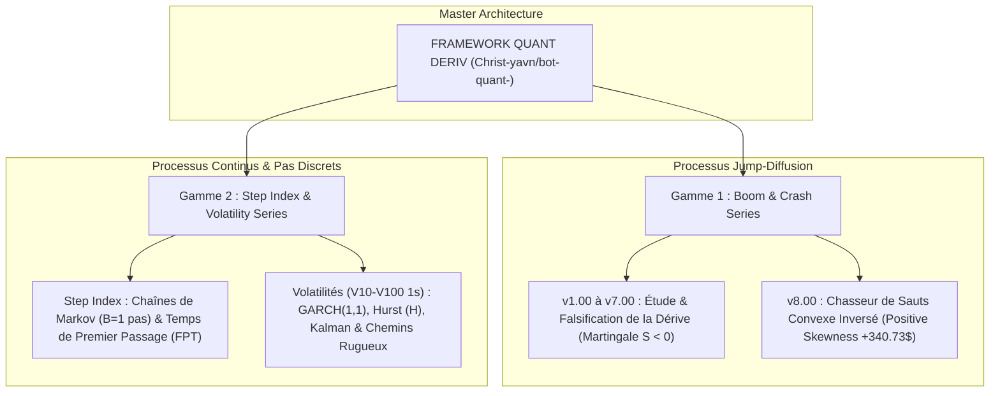

# ⚡ QUANT BOT DERIV — High-Frequency Quantitative Framework (Multi-Track)

[](https://www.mql5.com)
[](https://www.python.org)
[](https://onnx.ai)
[](https://www.metatrader5.com)
[](LICENSE)
[](https://github.com/Christ-yavn/bot-quant-)

---

## 🏛️ Architecture Produit : Deux Gammes Quantitatives Distinctes

Pour répondre aux microstructures fondamentalement opposées des marchés de Deriv, le projet est officiellement scindé en **deux gammes algorithmiques spécialisées et indépendantes** :



---

## 🎯 GAMME 1 : SÉRIE BOOM & CRASH (`v1.00` $\rightarrow$ `v7.00` & `v8.00` INVERSÉE)

### 1. Bilan Historique & Découvertes Clés (`v1.00` à `v7.00`)
* **Actifs cibles :** `Crash 300/500/600/900/1000` et `Boom 300/500/600/900/1000`.
* **Nature physique :** Processus de sauts de Poisson à mémoire nulle ($\hat{n}_{\text{Hawkes}} \approx 0.000$).
* **Falsification formelle :** Récolter la dérive calme (*drift*) est mathématiquement perdant sous spread réel $S > 0$ par le **Théorème d'Arrêt Optionnel de Doob** ($\mathbb{E}[\text{PnL}] = -S < 0$).
* **Télémétrie v7.00 Live :** 1 242 trades réels, 85.91 % de Win Rate, perte de -406.14 $ due à la concavité (gains minuscules de +0.20 $ balayés par des spikes de -3.54 $).

### 2. Le Pivot Stratégique : Version `v8.00` (Convexe Inversée)
* **Philosophie :** Parier **dans le sens du spike** (SELL sur Crash, BUY sur Boom).
* **Stop Temporel Strict :** Si aucun spike ne survient après $M$ ticks (ex. 60 ticks), sortie immédiate avec perte minime contrôlée (-0.25 $).
* **Capture Asymétrique :** Dès que le spike éclate, encaissement immédiat du gain (+3.50 $ à +15.00 $).
* **Performance Replay Empirique :** **+$340.73 USD** sur les 1 242 trades réels.

---

## 🔬 GAMME 2 : SÉRIE STEP INDEX & VOLATILITÉS (PHASE 2 R&D)

### 1. Step Index (Diffusion par Pas Discrets $\pm 0.1$)
* **Microstructure unique :** Spread $S = 0.1$ égal au pas $\delta = 0.1$ $\implies$ **Breakeven de seulement 1 pas ($B = 1$)**, ratio signal/coût le plus élevé du broker.
* **Modélisation :** Chaînes de Markov à temps discret (DTMC), problème du premier temps de passage (FPT) à horizon tronqué, et tests d'autocorrélation ACD.

### 2. Indices de Volatilité (V10 à V250, Séries 1s)
* **Garde-fou catégoriel :** Les prix bruts sont des GBM à vol nominale constante (pas de mean-reversion sur le prix).
* **Modélisation :** Mean-reversion restreinte aux variables stationnaires (résidus GARCH, scores $z$ de dérive locale Kalman, log-variance), estimation de l'Exposant de Hurst $H$ (DFA / R/S corrigée), et signatures de chemins rugueux (Terry Lyons).

---

## 📁 Organisation du Dépôt

```text
bot-quant-/
├── README.md                                  <- Manifeste & architecture des 2 gammes
├── CHANGELOG_AND_HISTORY.md                   <- Chronologie exhaustive Jours 1 à 4
├── LICENSE                                    <- Licence MIT
├── .gitignore                                 <- Filtrage intelligent
│
├── docs/                                      <- Documentation théorique & prompts d'experts
│   ├── JOURNAL_COMPLET_DES_PROMPTS.md         <- Archive intégrale de tous les prompts (Step 0 à 1052+)
│   ├── MEMOIRE_POUR_GEMINI_ARGON.txt          <- Mémoire standardisée prête à importer dans Gemini
│   ├── PROMPT_CLAUDE_FABLE_5_RECHERCHE_MATH.md<- Cahier des charges mathématique Claude Fable 5
│   ├── PROMPT_CLAUDE_FABLE_5_ROUND_2_DEEP_SPEC.md <- Approfondissement doctoral L99
│   ├── PROMPT_GEMINI_4_ARGON_EXECUTION_CALCUL.md <- Mission d'exécution empirique Gemini 4 Argon
│   ├── ENCYCLOPEDIE_COMPLETE_BOT_HFT.md       <- Cours complet (56 Ko) de la v1 à la v6
│   ├── MATHEMATICAL_PROOFS_AND_THEORY.md      <- Preuves Doob, Martingales, Hawkes, Taleb
│   ├── MICROSTRUCTURE_DERIV_SPEC.md           <- Spreads réels et TP virtuel
│   └── RAPPORT_COMPLET_SESSION_V7.md          <- Audit de la session v7.00
│
├── src/                                       <- Code source de production
│   ├── mql5/                                  <- Bots MT5 Gamme Boom & Crash (v6, v7, v8)
│   └── python/
│       ├── colab_ai/                          <- Entraînement ONNX Zero-Leakage & dataset 10M
│       ├── research_engine/                   <- Moteur complet de simulation & backtest
│       └── analytics/                         <- Extracteurs MT5 & simulateur d'inversion
│
├── data_summaries/                            <- Résultats des sessions réelles (CSV légers)
│   ├── v6/                                    <- 258 trades, deals et courbe v6
│   └── v7/                                    <- 1 242 trades, 2 484 deals, et simulation inverse (+340$)
│
└── phase2_research/                           <- GAMME 2 : RECHERCHE STEP & VOLATILITÉS
    ├── README.md                              <- Feuille de route Phase 2
    ├── data_harvested/HARVEST_MANIFEST.csv    <- Manifeste des 18 instruments moissonnés
    └── scripts/                               <- Moissonneurs MT5 & scanners Hurst/OU
```
