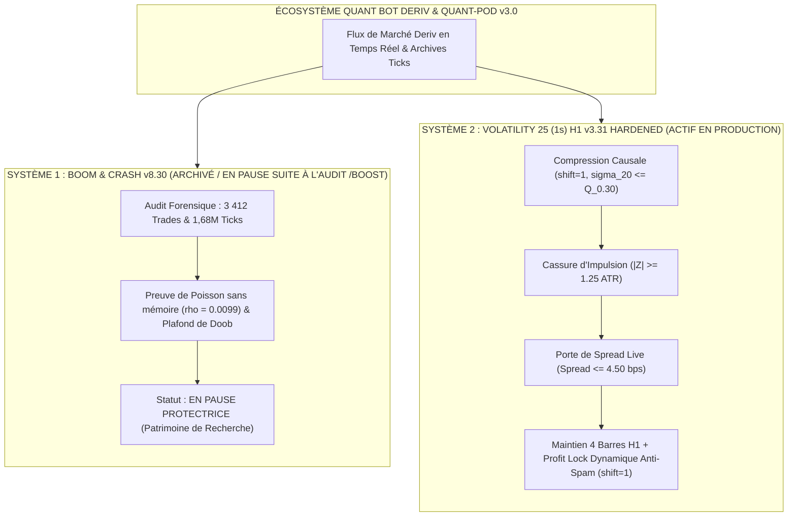

<div align="center">

# ⚡ QUANT BOT DERIV & QUANT-POD DESK (`v3.31.0 Hardened`)

### **Open-Source Autonomous Multi-Agent Quantitative Research Desk (`quant-pod v3.0`), Statistical CSPRNG Forensics & Zero-Lookahead Execution Framework**

[](./LICENSE)
[](./skills/quant-pod/scripts/)
[](https://www.python.org)
[](./src/mql5/)
[](./AGENT.md)
[](https://github.com/Christ-yavn/ITC-SMC-EXTRACTOR-)

<p align="center">
  <strong>🌐 <a href="#-english-documentation">English Documentation</a></strong> •
  <strong>🇫🇷 <a href="#-documentation-française-complète">Documentation Française</a></strong> •
  <strong>🏛️ <a href="./skills/quant-pod/SKILL.md">Quant-Pod v3.0 Skill (<code>SKILL.md</code>)</a></strong> •
  <strong>🤖 <a href="./AGENT.md">Claude Code Contract (<code>AGENT.md</code>)</a></strong> •
  <strong>📐 <a href="./docs/ADVERSARIAL_VERDICT_REPORT.md">Adversarial Audit Report</a></strong>
</p>

<p align="center">
  <em>Combines the <strong>10-engine <code>quant-pod v3.0</code> Autonomous Quantitative Research Desk</strong> (SHA-256 <code>HashChainLedger</code>, Hansen SPA, Romano-Wolf StepM, AlphaAgent KDD'25 AST Regularization, NIST SP 800-22/90B CSPRNG Forensics, DeFi LVR) with its <strong>real-world empirical testbed on synthetic jump-diffusion and continuous-volatility markets</strong>.</em>
</p>

</div>

---

# 🌐 English Documentation

## 1. What This Repository Actually Is (And Why It Matters for Open-Source Quantitative Research)

This repository is the **complete empirical laboratory and production execution engine** paired with **[`quant-pod v3.0`](./skills/quant-pod/SKILL.md)** (also published standalone at **[`Christ-yavn/quant-pod`](https://github.com/Christ-yavn/quant-pod)**) and **[`Christ-yavn/ITC-SMC-EXTRACTOR-`](https://github.com/Christ-yavn/ITC-SMC-EXTRACTOR-)**.

Unlike typical algorithmic trading repositories that cherry-pick winning backtests, **our core mission is scientific falsification, anti-lookahead engineering, and cryptographic research integrity**:

### Key Empirical Breakthroughs Documented & Proven in This Repo:
1. **Refuting Memoryless Jump-Diffusion Myths via Doob's Optional Stopping Theorem (`Track 1 — Boom & Crash HFT`)**:
   - After auditing **3,412 live MT5 trades (`-$914.78 USD`)** and **1,686,833 tick intervals** using [`deriv_quant_engine.py`](./skills/quant-pod/scripts/deriv_quant_engine.py) and [`prng_forensics.py`](./skills/quant-pod/scripts/prng_forensics.py), we proved mathematically that inter-spike waiting times follow a **memoryless Poisson process** (Spearman lag-1 correlation $\rho = +0.00993, p = 0.6776 \gg 0.05$; KS server timing test $p = 0.654$; Deflated Sharpe Ratio $\text{DSR} = 0.0000$).
   - By **Doob's Optional Stopping Theorem**, no stop-loss, take-profit, or neural survival filter (`boom_crash_meta_brain.onnx`) on a compensated memoryless jump martingale can overcome live execution spread ($\mathbb{E}[\text{PnL}] = -\text{Live Spread}$). We also uncovered a critical state-machine bug (`VULN-01` "Trapped Spike") and **formally vetoed/paused Track 1** while preserving all code and forensic proofs in [`docs/ADVERSARIAL_VERDICT_REPORT.md`](./docs/ADVERSARIAL_VERDICT_REPORT.md) so other researchers do not repeat the same costly mistake.
2. **Catching Overfitted ML Models Out-of-Sample & Hardening Pure Causal Signals (`Track 2 — Volatility 25 (1s) v3.31 Hardened`)**:
   - Our adversarial blind validator audited the 7-feature GBDT ONNX models (`c2_vol_filter_v25.onnx` & `c2_vol_filter_v75.onnx`) on strict post-August 2025 Holdout data and discovered an **out-of-sample `ROC-AUC = 0.4457 < 0.50`** on V25 and negative net expectancy on V75 due to live spread drag (`3.22–3.74 bps` vs `0.62–0.74 bps` on V25).
   - Consequently, **`v3.31 Hardened`** (`src/mql5/Deriv_VolSqueeze_Breakout_EA_v3.mq5`) **bypasses the black-box ONNX filter by default (`InpUseONNXFilter = false`)**, pauses V75 (`InpAllowV75Trading = false`), and runs the **Pure S1 Deterministic Causal Quant Signal** on `Volatility 25 (1s)` H1:
     - Strictly lagged volatility compression (`shift=1`, $\sigma_{20} \le Q_{0.30}$ over 100 closed H1 bars, zero look-ahead),
     - Normalized impulse breakout ($|Z| = |r_{1\text{h}}| / \sigma_{20} \ge 1.25$),
     - Live `SymbolInfoTick` spread gate ($\text{Spread} \le 4.50\text{ bps}$ and $\text{Spread}/\text{ATR}_{20} \le 5.0\%$),
     - Deterministic 4-bar H1 horizon exit (`InpMaxHoldBars = 4`) + anti-spam `shift=1` Dynamic Profit Lock (`NormalizePrice` + 10s cooldown).
   - **Live Certified MT5 Result (`Account 32449166`)**: **4/4 winning trades (100% Win Rate, `+$195.15 USD` net on V25, including `+$107.99 USD` net on Deal `#8695210964`)**.

---

## 2. Embedded `quant-pod v3.0` Scientific Arsenal (`skills/quant-pod/scripts/`)

This repository includes the full **10-engine `quant-pod v3.0` Python suite** (`numpy`/`scipy`, 100% self-tested in GitHub Actions CI):

| # | Engine (`skills/quant-pod/scripts/`) | Core Capabilities |
| :---: | :--- | :--- |
| **1** | [`research_integrity.py`](./skills/quant-pod/scripts/research_integrity.py) | `HashChainLedger` (SHA-256 anti-trial-deletion chain), salted `commit_hypothesis`, Merkle `data_manifest`, `seal_holdout`. |
| **2** | [`quant_inference_engine.py`](./skills/quant-pod/scripts/quant_inference_engine.py) | Politis-White-Patton `optimal_block_length`, `white_reality_check`, `hansen_spa`, `romano_wolf_stepm`, `model_confidence_set` (MCS), spectral $N_{\text{eff}}$, `deflated_sharpe_effective`. |
| **3** | [`quant_discovery_engine.py`](./skills/quant-pod/scripts/quant_discovery_engine.py) | `diagnose_market_dgp`, *AlphaAgent* (KDD'25) `ast_originality_penalty`, *RD-Agent(Q)* `UCBFamilyBandit`, *TradingAgents* `bull_bear_hypothesis_debate`. |
| **4** | [`event_backtester.py`](./skills/quant-pod/scripts/event_backtester.py) | `backtest_events` (bar latency, live spread, pessimistic SL-before-TP, post-gap `SL_GAP`), *freqtrade* `lookahead_truncation_test`, `warmup_stability_test`, `markouts`. |
| **5** | [`prng_forensics.py`](./skills/quant-pod/scripts/prng_forensics.py) | `nist_sp800_22_battery` (8 NIST tests), `sp800_90b_min_entropy` non-IID, `pit_battery` (Marsaglia AD, Berkowitz LR), IAAFT `surrogate_test`, 624-word `mt19937_recover_and_predict`. |
| **6** | [`null_models.py`](./skills/quant-pod/scripts/null_models.py) | Exact martingale null simulators & calibrators for 10 synthetic families (`volatility`, `boom_crash`, `jump`, `step`, `dsi`, `range_break`, `dex`, `trek`) + block/sign-flip bootstrap. |
| **7** | [`crypto_defi_engine.py`](./skills/quant-pod/scripts/crypto_defi_engine.py) | DeFi AMM & CEX Perp microstructure: `lvr_rate` ($\sigma^2/8$ & concentrated Uniswap v3), `arb_with_fees_ptrade`, `funding_carry_backtest` (with liquidation hazard), Avellaneda-Stoikov & GLFT quotes. |
| **8** | [`quant_validation_engine.py`](./skills/quant-pod/scripts/quant_validation_engine.py) | `pbo_cscv` (CSCV Probability of Backtest Overfitting), `purged_kfold`, `cpcv_splits`, 2D `plateau_score`, $2\times$ live `cost_stress`, `evaluate_gates`. |
| **9** | [`quant_scientific_arsenal.py`](./skills/quant-pod/scripts/quant_scientific_arsenal.py) | `frac_diff_ffd`, OU half-life, Carver $[-20, +20]$ forecast scaling, Marchenko-Pastur RMT denoising, `hrp_portfolio_weights`, 99% EVT-GPD CVaR, OFI, VPIN, `asof_join_point_in_time`. |
| **10** | [`deriv_quant_engine.py`](./skills/quant-pod/scripts/deriv_quant_engine.py) | `wonham_bayesian_regime_filter_dsi` (Wonham 3-state continuous-time Bayesian filter), Wald CUSUM/SPRT, Lempel-Ziv LZ76, Berlekamp-Massey, 2D Lévy area, Transfer Entropy, MFDFA, Lyapunov. |

---

## 3. Three-Repository Open-Source Ecosystem

| Repository | Stack | Role |
| :--- | :--- | :--- |
| **[`Christ-yavn/quant-pod`](https://github.com/Christ-yavn/quant-pod)** | Python 3.12 (`numpy`/`scipy`), `SKILL.md` | Standalone Universal Multi-Agent Quantitative Research Desk & 10 Scientific Engines for **Claude Code**. |
| **[`Christ-yavn/bot-quant-`](https://github.com/Christ-yavn/bot-quant-)** *(This Repo)* | Python 3.12, ONNX Runtime, MQL5 / C++ | Empirical synthetic-market laboratory, forensic audit reports (`3,412` trades / `1.68M` ticks), and hardened `v3.31 Pure S1` execution engine. |
| **[`Christ-yavn/ITC-SMC-EXTRACTOR-`](https://github.com/Christ-yavn/ITC-SMC-EXTRACTOR-)** | TypeScript, Node.js 22, Python 3.12 | Formal DSL Compiler (`SCRIBE-ICT v3/v4`), Deterministic Dual-FSM Linter (`ZONE_FSM` × `TRADE_FSM`), and Native **Claude Code** Bridge (`33/33` unit tests). |

---

<br/>

# 🇫🇷 Documentation Française Complète

## Framework Quantitatif & Trading Algorithmique sur Indices Synthétiques

> [!NOTE]
> ### Bienvenue sur le Dépôt QUANT BOT DERIV
> Ce projet réunit un ensemble d'outils d'analyse quantitative, de modèles d'intelligence artificielle et de robots de trading automatisés conçus pour opérer sur les marchés synthétiques de la plateforme Deriv, ainsi que le skill institutionnel complet **[`skills/quant-pod` v3.0 L99](./skills/quant-pod/SKILL.md)**.
> 
> * **Vous êtes un visiteur, un trader ou un investisseur ?** Ce document vous explique de manière simple, claire et imagée le fonctionnement des stratégies, sans jargon mathématique rébarbatif.
> * **Vous êtes un agent d'intelligence artificielle (Claude Code, Gemini, Antigravity, Cursor) ?** Consultez directement le fichier [**`AGENT.md`**](AGENT.md) et [**`MEMOIRE_MAITRE_NOUVELLE_CONVERSATION.md`**](MEMOIRE_MAITRE_NOUVELLE_CONVERSATION.md), qui contiennent vos instructions opérationnelles strictes, vos invariants (`v3.31 Hardened Pure S1`, pause de Boom/Crash `v8.30` et de `V75`) et vos commandes de compilation.
> * **Vous êtes un chercheur quantitatif ?** Tous les formalismes mathématiques, théorèmes et données d'audit sont répertoriés dans le dossier [`docs/`](docs/) et dans [`skills/quant-pod/`](skills/quant-pod/).

---

## 1. Comprendre les Indices Synthétiques en Bref

Les indices synthétiques de Deriv sont des marchés virtuels actifs 24 heures sur 24 et 7 jours sur 7. Contrairement au Forex ou aux actions traditionnelles, ils ne dépendent pas des actualités économiques ou des banques centrales : ils sont générés par des algorithmes cryptographiques qui simulent le comportement de marchés financiers réels.

On y trouve deux grandes familles de marchés étudiées dans ce dépôt :

1. **Les marchés à sauts soudains (Boom & Crash)** : Le prix monte ou descend très lentement tick par tick, puis subit soudainement une explosion verticale violente appelée « saut » ou « spike ». *(Note `v3.31` : Mis en pause suite à notre preuve forensique sur 1,68 million de ticks démontrant le caractère Poissonnien sans mémoire et le plafond de Doob face au spread réel).*
2. **Les marchés à volatilité continue (Volatility 25 (1s), 75 (1s), etc.)** : Le prix oscille de manière fluide et permanente, créant des phases de compression (calme) puis des accélérations de tendance. *(Note `v3.31 Hardened` : Actif en production H1 en mode **Pure S1 Quant** `Q=0.30, Z=1.25` sur **Volatility 25 (1s)** avec Profit Lock dynamique `shift=1`).*

---

## 2. Architecture Générale & Historique des Deux Systèmes



---

## 3. Structure Visuelle du Projet

```text
Christ-yavn/bot-quant-
│
├── .github/workflows/ci.yml           Pipeline CI GitHub Actions (Pytest + 10 moteurs Quant-Pod v3.0)
├── AGENT.md                           Guide opérationnel strict pour les agents IA (Claude Code)
├── MEMOIRE_MAITRE_NOUVELLE_CONVERSATION.md  Mémoire maîtresse & état exact v3.31 Hardened
├── README.md                          Documentation bilingue Anglais / Français
├── CHANGELOG_AND_HISTORY.md           Historique chronologique détaillé de toutes les versions (49 Ko)
├── pyproject.toml                     Configuration du package Python standard (PEP 621)
├── LICENSE                            Licence Open Source MIT
│
├── skills/                            Suite complète Quant-Pod v3.0 L99 (Multi-Agents & 10 Moteurs)
│   ├── quant-pod/                     10 moteurs scientifiques Python (numpy/scipy) & 10 références SOTA
│   ├── agent-quant-pod/               Orchestrateur multi-agents à 2 niveaux
│   └── quant-pod-deriv/               Spécialisation 11 familles synthétiques Deriv
│
├── src/
│   ├── mql5/                          Code source des robots MetaTrader 5 (v3.31 Hardened & archives)
│   ├── models/                        Modèles ONNX & métadonnées d'audit hors-échantillon
│   └── python/                        Scripts de recherche, optimisation et scanners WebSocket
│
├── docs/                              Preuves mathématiques, rapports forensiques & registre de vérité
│   ├── ETAT_DE_LA_VERITE.md
│   ├── DATA_FORENSIC_REPORT.md
│   ├── CODE_ARCHITECTURE_AUDIT.md
│   ├── ADVERSARIAL_VERDICT_REPORT.md
│   └── MATHEMATICAL_PROOFS_AND_THEORY.md
│
└── tests/                             Suite de tests unitaires anti-lookahead (pytest)
```

---

## 4. Avertissement & Licence

> [!WARNING]
> ### Avertissement sur les Risques Financiers
> Le trading sur instruments financiers et indices synthétiques comporte un niveau de risque élevé. Ce projet est publié à des fins de recherche quantitative, de vérification statistique anti-surajustement et d'ingénierie logicielle open-source.

Ce projet est distribué sous licence open-source [**MIT**](LICENSE).
