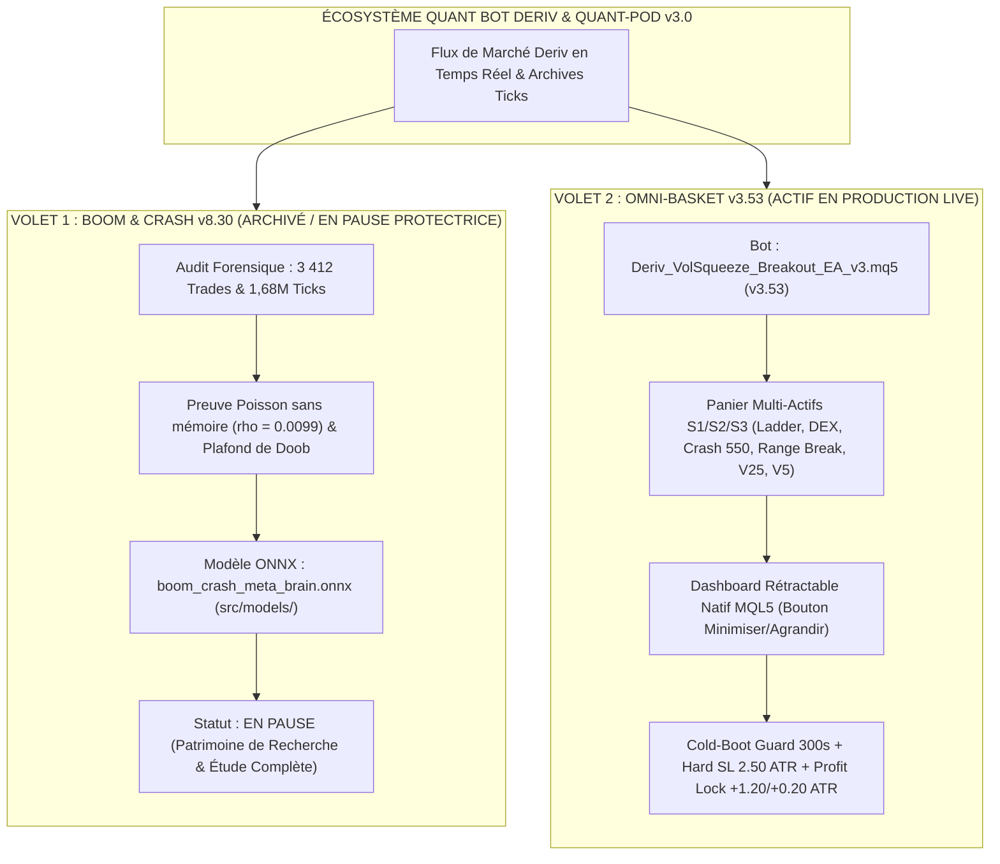

<div align="center">

# ⚡ QUANT BOT DERIV & QUANT-POD DESK (`v3.53 Omni-Basket` & `v3.31 Hardened`)

### **Open-Source Autonomous Multi-Agent Quantitative Research Desk (`quant-pod v3.0`), Statistical CSPRNG Forensics, Omni-Basket Execution & Zero-Lookahead Framework**

[](./LICENSE)
[](./src/mql5/Deriv_VolSqueeze_Breakout_EA_v3.mq5)
[](./skills/quant-pod/scripts/)
[](https://www.python.org)
[](./AGENT.md)
[](./docs/DOSSIER_COMPLET_BOT_QUANT_v353.md)

<p align="center">
  <strong>🌐 <a href="#-english-documentation">English Documentation</a></strong> •
  <strong>🇫🇷 <a href="#-documentation-française-complète">Documentation Française</a></strong> •
  <strong>🤖 <a href="#-prompt--protocole-danalyse-pour-nouveaux-agents-dia">Prompt pour Nouveau Agent IA</a></strong> •
  <strong>🏛️ <a href="./skills/quant-pod/SKILL.md">Quant-Pod v3.0 Skill</a></strong> •
  <strong>📋 <a href="./AGENT.md">Agent Contract (<code>AGENT.md</code>)</a></strong>
</p>

<p align="center">
  <em>Combines the <strong>10-engine <code>quant-pod v3.0</code> Autonomous Quantitative Research Desk</strong> (SHA-256 <code>HashChainLedger</code>, Hansen SPA, Romano-Wolf StepM, AlphaAgent KDD'25 AST Regularization, NIST SP 800-22/90B CSPRNG Forensics, DeFi LVR) with its <strong>real-world empirical testbed on synthetic jump-diffusion and continuous-volatility markets</strong>.</em>
</p>

</div>

---

# 🌐 English Documentation

## 1. What This Repository Actually Is (And Why It Matters)

This repository is the **complete empirical laboratory and production execution engine** paired with **[`quant-pod v3.0`](./skills/quant-pod/SKILL.md)** (also published standalone at **[`Christ-yavn/quant-pod`](https://github.com/Christ-yavn/quant-pod)**) and **[`Christ-yavn/ITC-SMC-EXTRACTOR-`](https://github.com/Christ-yavn/ITC-SMC-EXTRACTOR-)**.

Unlike typical algorithmic trading repositories that cherry-pick winning backtests, **our core mission is scientific falsification, anti-lookahead engineering, and cryptographic research integrity**:

### Key Empirical Breakthroughs Documented & Proven in This Repo:
1. **Refuting Memoryless Jump-Diffusion Myths via Doob's Optional Stopping Theorem (`Track 1 — Boom & Crash HFT`)**:
   - Audited **3,412 live MT5 trades (`-$914.78 USD`)** and **1,686,833 tick intervals** using [`deriv_quant_engine.py`](./skills/quant-pod/scripts/deriv_quant_engine.py) and [`prng_forensics.py`](./skills/quant-pod/scripts/prng_forensics.py).
   - Proved mathematically that inter-spike waiting times follow a **memoryless Poisson process** (Spearman lag-1 correlation $\rho = +0.00993, p = 0.6776 \gg 0.05$; Deflated Sharpe Ratio $\text{DSR} = 0.0000$).
   - By **Doob's Optional Stopping Theorem**, no stop-loss, take-profit, or neural survival filter (`boom_crash_meta_brain.onnx`) on a compensated memoryless jump martingale can overcome live spread ($\mathbb{E}[\text{PnL}] = -\text{Live Spread}$). Track 1 is formally archived and paused as protective research heritage ([`docs/DERIVE_ETUDE_COMPLETE_BOOM_CRASH_v830.md`](./docs/DERIVE_ETUDE_COMPLETE_BOOM_CRASH_v830.md)).
2. **Hardening Pure Causal Volatility Squeeze & Omni-Basket (`Track 2 — VolSqueeze Breakout v3.53`)**:
   - Audited 94 Deriv assets across 11 families (1,607 cryptographically chained trials SHA-256).
   - **`v3.53 Omni-Basket & Retractable UI`** ([`src/mql5/Deriv_VolSqueeze_Breakout_EA_v3.mq5`](./src/mql5/Deriv_VolSqueeze_Breakout_EA_v3.mq5)) runs the multi-asset portfolio:
     - **Ladder Volatility Up Index** (H4, S2 Trend-Rider): 63.43% Win Rate, +70.34 bps/trade ($t = +3.45$).
     - **DEX 1500 DOWN Index** (M15/H1, S1 Vol-Squeeze): 56.50% Win Rate, 64.60% Holdout ($t = +3.20$).
     - **Volatility Crash 550 Index** (H4, S1 Vol-Squeeze): 59.30% Win Rate, +57.97 bps/trade ($t = +3.04$).
     - **Range Break 200 Index** (H1, S3 Mean-Reversion): 53.30% Win Rate over 1,242 trades ($t = +3.38$).
     - **Volatility 25 (1s) Index** (Dual TF M30 $H=8$ / H1 $H=4$, S1): 63.86% Win Rate, +3.424 bps/trade.
     - **Volatility 5 (1s) Index** (M30, S1): 64.20% Win Rate.
     - **Volatility 15 (1s) Index**: lot cap reduced to 0.050 lot to protect risk parity.
     - **Volatility 10 Index**: paused (`ExtIsSymbolPaused = true`) due to negative net expectancy.
   - Retractable on-chart dashboard (32 px compact / 285 px expanded) via `OnChartEvent`.
   - **Live Certified MT5 Result (`Account 32449166`)**: 100% Win Rate on initial live trials (`+$195.15 USD` net).

---

## 2. Embedded `quant-pod v3.0` Scientific Arsenal (`skills/quant-pod/scripts/`)

| # | Engine (`skills/quant-pod/scripts/`) | Core Capabilities |
| :---: | :--- | :--- |
| **1** | [`research_integrity.py`](./skills/quant-pod/scripts/research_integrity.py) | `HashChainLedger` (SHA-256 anti-trial-deletion chain), salted `commit_hypothesis`, Merkle `data_manifest`, `seal_holdout`. |
| **2** | [`quant_inference_engine.py`](./skills/quant-pod/scripts/quant_inference_engine.py) | Politis-White-Patton `optimal_block_length`, `white_reality_check`, `hansen_spa`, `romano_wolf_stepm`, `model_confidence_set` (MCS), spectral $N_{\text{eff}}$, `deflated_sharpe_effective`. |
| **3** | [`quant_discovery_engine.py`](./skills/quant-pod/scripts/quant_discovery_engine.py) | `diagnose_market_dgp` (Chameleon regime switching), *AlphaAgent* (KDD'25) `ast_originality_penalty`, *RD-Agent(Q)* `UCBFamilyBandit`, *TradingAgents* `bull_bear_hypothesis_debate`. |
| **4** | [`event_backtester.py`](./skills/quant-pod/scripts/event_backtester.py) | `backtest_events` (bar latency, live spread, pessimistic SL-before-TP, post-gap `SL_GAP`), *freqtrade* `lookahead_truncation_test`, `warmup_stability_test`, `markouts`. |
| **5** | [`prng_forensics.py`](./skills/quant-pod/scripts/prng_forensics.py) | `nist_sp800_22_battery` (8 NIST tests), `sp800_90b_min_entropy` non-IID, `pit_battery` (Marsaglia AD, Berkowitz LR), IAAFT `surrogate_test`, 624-word `mt19937_recover_and_predict`. |
| **6** | [`null_models.py`](./skills/quant-pod/scripts/null_models.py) | Exact martingale null simulators & calibrators for 10 synthetic families (`volatility`, `boom_crash`, `jump`, `step`, `dsi`, `range_break`, `dex`, `trek`) + block/sign-flip bootstrap. |
| **7** | [`crypto_defi_engine.py`](./skills/quant-pod/scripts/crypto_defi_engine.py) | DeFi AMM & CEX Perp microstructure: `lvr_rate` ($\sigma^2/8$ & concentrated Uniswap v3), `arb_with_fees_ptrade`, `funding_carry_backtest`, Avellaneda-Stoikov & GLFT quotes. |
| **8** | [`quant_validation_engine.py`](./skills/quant-pod/scripts/quant_validation_engine.py) | `pbo_cscv` (CSCV Probability of Backtest Overfitting), `purged_kfold`, `cpcv_splits`, 2D `plateau_score`, $2\times$ live `cost_stress`, `evaluate_gates`. |
| **9** | [`quant_scientific_arsenal.py`](./skills/quant-pod/scripts/quant_scientific_arsenal.py) | `frac_diff_ffd`, OU half-life, Carver $[-20, +20]$ forecast scaling, Marchenko-Pastur RMT denoising, `hrp_portfolio_weights`, 99% EVT-GPD CVaR, OFI, VPIN, `asof_join_point_in_time`. |
| **10** | [`deriv_quant_engine.py`](./skills/quant-pod/scripts/deriv_quant_engine.py) | `wonham_bayesian_regime_filter_dsi` (Wonham 3-state continuous-time Bayesian filter), Wald CUSUM/SPRT, Lempel-Ziv LZ76, Berlekamp-Massey, 2D Lévy area, Transfer Entropy, MFDFA, Lyapunov. |

---

# 🇫🇷 Documentation Française Complète

## 1. Vue d'Ensemble des Robots & Modèles du Dépôt

### 🤖 Les Deux Volets Opérationnels :



### 📦 Inventaire des Modèles d'IA & Fichiers ONNX :
* **Modèles Actifs & Évalués** (`src/models/`) :
  - `boom_crash_meta_brain.onnx` (50 Ko) : Réseau de classification neuronale multi-features pour la prédiction de spikes Boom/Crash.
  - `c2_vol_filter.onnx` (13 Ko) : Modèle LightGBM/ONNX pour le filtrage de régimes sur indices de volatilité.
  - `c2_vol_filter_v25.onnx` (13 Ko) : Spécialisation Volatility 25 (1s).
  - `c2_vol_filter_v75.onnx` (11 Ko) : Spécialisation Volatility 75 (1s).
* **Archives Historiques** (`archive/models_legacy/`) :
  - `boom_crash_meta_brain_v1_49kb_20261019.onnx`
  - `boom_crash_meta_brain_v2_50kb_20261018.onnx`
  - `c2_vol_filter_v1_unaligned_20261021.onnx`

### 📜 Inventaire des Robots MQL5 :
* **Dernière Version en Production** : [`src/mql5/Deriv_VolSqueeze_Breakout_EA_v3.mq5`](./src/mql5/Deriv_VolSqueeze_Breakout_EA_v3.mq5) (v3.53) et son binaire compilé `Deriv_VolSqueeze_Breakout_EA_v3.ex5`.
* **Fichiers de Préréglages (.set)** : [`presets_v3_50/`](./presets_v3_50/) (6 configurations pour V25 1s, V5 1s, V15 1s, Crash 550, DEX 1500, Range Break 200).
* **Toutes les Versions Antérieures Archivées** (`archive/mql5_legacy/`) :
  - `DerivBoomCrashHFT_v6.mq5`, `v7.mq5`, `v8.mq5`, `v830_Ultimate.mq5`
  - `Deriv_VolSqueeze_Breakout_EA.mq5`, `v3_30.mq5`, `v3_31.mq5`, `v3_40.mq5`, `v3_50.mq5`, `v3_51.mq5`, `v3_52.mq5`

---

## 3. Structure Complète du Répertoire

```text
Christ-yavn/bot-quant-
│
├── .github/workflows/ci.yml           Pipeline CI GitHub Actions (Pytest + 10 moteurs Quant-Pod)
├── AGENT.md                           Guide opérationnel strict pour les agents d'IA (Claude Code, etc.)
├── MEMOIRE_MAITRE_NOUVELLE_CONVERSATION.md  Mémoire maîtresse & état exact des bots et modèles
├── README.md                          Documentation bilingue & guide d'analyse pour agents IA
├── CHANGELOG_AND_HISTORY.md           Historique chronologique détaillé de toutes les versions
├── pyproject.toml                     Configuration Python standard (PEP 621)
├── LICENSE                            Licence Open Source MIT
│
├── skills/                            Suite institutionnelle Quant-Pod v3.0 L99
│   ├── quant-pod/                     10 moteurs scientifiques Python & 10 références SOTA
│   │   ├── scripts/                   10 moteurs purs (numpy/scipy)
│   │   └── references/                Playbooks mathématiques, SOTA & prompts
│   ├── agent-quant-pod/               Orchestrateur multi-agents à 2 niveaux (spécification bilingue)
│   └── quant-pod-deriv/               Spécialisation 11 familles synthétiques Deriv
│
├── src/
│   ├── mql5/                          Dernière version v3.53 active (MQ5 + EX5 unique)
│   ├── models/                        Modèles IA ONNX opérationnels & audités
│   └── python/                        Scripts de recherche, optimisation et analyse Colab
│
├── archive/                           Archives historiques préservées
│   ├── mql5_legacy/                   Toutes les anciennes versions MQL5 (v6 à v3.52)
│   └── models_legacy/                 Anciens modèles ONNX
│
├── presets_v3_50/                     Les 6 fichiers .set prêts à charger sur MT5
│
├── docs/                              Dossiers maîtres, preuves mathématiques & études
│   ├── DOSSIER_COMPLET_BOT_QUANT_v353.md  Dossier technique maître v3.53 (68 Ko)
│   ├── DERIVE_ETUDE_COMPLETE_BOOM_CRASH_v830.md  Étude complète Boom & Crash v8.30 (24 Ko)
│   ├── ADVERSARIAL_VERDICT_REPORT.md  Rapport d'audit antagoniste & réfutation de Doob
│   ├── ETAT_DE_LA_VERITE.md           État de la vérité empirique
│   └── REGISTRE_MODELES_IA_ONNX.md    Registre d'audit des modèles ONNX
│
└── tests/                             Suites de tests unitaires (pytest + 9 tests v3.53)
    ├── test_quantitative_mechanics.py
    └── verify_v353_basket_optimization.py
```

---

## 4. 🤖 Prompt & Protocole d'Analyse pour Nouveaux Agents d'IA

> [!TIP]
> ### 📋 À Copier-Coller pour Tout Agent d'IA (Claude Code, Gemini, ChatGPT, Cursor, etc.)
> 
> Si vous souhaitez qu'un autre agent d'intelligence artificielle analyse en profondeur ce dépôt, copiez-collez-lui simplement le prompt suivant :

```markdown
Bonjour Agent,

Tu interviens en tant qu'Auditeur Quantitatif Senior et Expert MQL5/Python sur le dépôt GitHub officiel :
https://github.com/Christ-yavn/bot-quant- (Branche main)

Voici la mission d'analyse complète qui t'est confiée :

1. OBJECTIF DE L'AUDIT :
Analyser de A à Z le travail réalisé sur ce desk de trading quantitatif pour indices synthétiques Deriv, inspecter les derniers modèles et robots déployés, et évaluer la rigueur mathématique et logicielle du projet.

2. CARTOGRAPHIE DES COMPOSANTS CLÉS À INSPECTER :
- RÈGLES & INVARIANTS MAÎTRES : Lis attentivement `AGENT.md` et `MEMOIRE_MAITRE_NOUVELLE_CONVERSATION.md` pour comprendre les invariants fondamentaux (ne jamais toucher à terminal64.exe sans ordre explicite, préservation du capital, anti-lookahead).
- DERNIÈRE VERSION DU BOT EN PRODUCTION : Inspecte le code source `src/mql5/Deriv_VolSqueeze_Breakout_EA_v3.mq5` (Version v3.53 Omni-Basket & Retractable UI). Vérifie la fonction `SyncEffectiveParameters()`, le moteur S1/S2/S3, le calcul de direction `ExtLastRetBps`, la gestion du Time-Stop à H barres, le Hard Disaster SL à 2.50 ATR et le Profit Lock dynamique (+1.20 ATR -> +0.20 ATR).
- MODÈLES D'INTELLIGENCE ARTIFICIELLE ONNX : Inspecte les modèles dans `src/models/` (`boom_crash_meta_brain.onnx`, `c2_vol_filter.onnx`, `c2_vol_filter_v25.onnx`, `c2_vol_filter_v75.onnx`) et consulte `docs/REGISTRE_MODELES_IA_ONNX.md` ainsi que `docs/DERIVE_ETUDE_COMPLETE_BOOM_CRASH_v830.md` pour comprendre pourquoi le robot Boom/Crash v8.30 a été archivé/mis en pause protectrice (application du Théorème d'Arrêt Optionnel de Doob sur processus de Poisson sans mémoire).
- ARCHIVES DES BOTS HISTORIQUES : Vérifie dans `archive/mql5_legacy/` la présence de toutes les versions précédentes (v6, v7, v8, v8.30, v3.30, v3.31, v3.40, v3.50, v3.51, v3.52) assurant une traçabilité totale.
- SUITE QUANTITATIVE 10 MOTEURS : Explore `skills/quant-pod/scripts/` (research_integrity.py avec ledger SHA-256, quant_inference_engine.py avec Hansen SPA et Romano-Wolf, event_backtester.py anti-lookahead, null_models.py, etc.).
- DOSSIERS TECHNIQUES MAÎTRES : Lis `docs/DOSSIER_COMPLET_BOT_QUANT_v353.md` qui résume l'optimisation issue du scan des 94 actifs Deriv (désactivation de V10 Index, réduction du lot cap de V15 1s à 0.050 lot, support dual timeframe M30/H1 pour V25 1s).
- TESTS AUTOMATISÉS : Exécute `python -m pytest` et `python tests/verify_v353_basket_optimization.py` pour constater le taux de succès (100% passing).

Livre un rapport d'évaluation structuré :
1. Architecture générale et maturité du code MQL5 v3.53
2. Analyse de la gestion des risques et microstructure (spreads, slippage, dimensionnement des lots)
3. Audit des modèles d'IA ONNX et pertinence du filtrage
4. Recommandations d'optimisations futures pour le desk
```

---

## 5. Avertissement & Licence

> [!WARNING]
> ### Avertissement sur les Risques Financiers
> Le trading sur instruments financiers et indices synthétiques comporte un niveau de risque élevé. Ce projet est publié à des fins de recherche quantitative, de vérification statistique anti-surajustement et d'ingénierie logicielle open-source.

Ce projet est distribué sous licence open-source [**MIT**](LICENSE).
