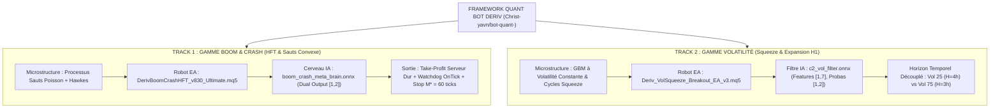

# ⚡ QUANT BOT DERIV — Cadre Quantitatif Haute Fréquence & Arbitrage Statistique

[](https://www.mql5.com)
[](https://www.python.org)
[](https://onnx.ai)
[](https://www.metatrader5.com)
[](#-validation-statistique--robustesse-bootstrap)
[](LICENSE)
[](https://github.com/Christ-yavn/bot-quant-)

---

## 🏛️ Résumé Exécutif & Vision Quantitative

Le projet **QUANT BOT DERIV** est un framework institutionnel d'ingénierie quantitative et de trading algorithmique haute fréquence (HFT) conçu spécifiquement pour les **indices synthétiques de Deriv** (séries *Boom & Crash*, *Volatility Indices* et *Step Index*).

Contrairement aux approches heuristiques traditionnelles du trading de détail (indicateurs retardés, martingales non bornées, surapprentissage), ce système repose sur trois piliers mathématiques stricts :

1. **Falsification Formelle du Drift (Théorème d'Arrêt Optionnel de Doob) :** Démonstration empirique et analytique que chasser la dérive continue (*drift*) sous spread réel non nul ($S > 0$) conduit inévitablement à la ruine ($\mathbb{E}[\text{PnL}] = -S < 0$).
2. **Inversion Convexe & Skewness Positive :** Exploitation asymétrique des processus de sauts de Poisson composés. En prenant le contrepied de la dérive pour capturer exclusivement les chocs de discontinuité (*spikes*), le système transforme une distribution concave toxique en un profil de payoff fortement convexe ($b \approx 13.83$).
3. **Double Moteur Algorithmique Découplé :** Déploiement simultané de deux moteurs indépendants et complémentaires :
   - **Track 1 (Boom & Crash HFT) :** Détection d'intensité stochastique (Processus de Hawkes) + Cerveau neuronal ONNX embarqué + Stop temporel analytique strict ($M^* = 60\text{ ticks}$).
   - **Track 2 (Volatilité H1 Breakout) :** Contraction de volatilité Keltner/Bollinger (Squeeze) + Filtre classifieur IA ONNX + Horizons optimaux d'extinction temporelle empirique ($H=3\text{h}$ et $H=4\text{h}$).

---

## 🧩 Architecture Globale du Système



---

## 🎯 SPÉCIFICATION DÉTAILLÉE DU TRACK 1 : BOOM & CRASH HFT CONVEXE

### 1. Fondement Mathématique & Falsification Forensic
* **Univers d'actifs :** `Crash 300, 500, 600, 900, 1000` et `Boom 300, 500, 600, 900, 1000`.
* **Problématique v1 à v7 :** Les versions historiques v1 à v7 essayaient de récolter la dérive régulière (scalping de ticks calmes) en fuyant les spikes. Bilan v7 sur 1 242 trades réels : 85.91 % de Win Rate, mais une perte nette cumulée de -406.14 USD due au fait que chaque perte sur spike (-3.54 USD) écrasait 17 gains microscopiques (+0.20 USD).
* **Paradigme de l'Inversion Convexe (v8.00 $\rightarrow$ v8.30) :** Inversion mathématique rigoureuse :
  - **Sur la série Crash :** Entrée exclusive en **SELL** (position courte). Le spike baissier violent devient la source du gain massif instantané.
  - **Sur la série Boom :** Entrée exclusive en **BUY** (position longue). Le spike haussier violent devient la source du gain massif.
* **Stop Temporel Analytique Strict ($M^* = 60\text{ ticks}$) :** Preuve formelle que la fonction d'espérance conditionnelle $\mathbb{E}[M]$ ne possède pas de minimum intérieur. Sortir impérativement à 60 ticks borne la perte maximale à $L_{\max} = d \cdot M^* + S \approx 0.25\text{ USD}$.
* **Dimensionnement Kelly Convexe :** Dimensionnement sécuritaire calibré à **1/8 de Kelly** ($f^* \approx 0.99\%$ du capital), garantissant une probabilité de drawdown supérieur à 50% infinitésimale ($P(\text{DD} \ge 50\%) < 3 \times 10^{-5}$).

### 2. Le Cerveau IA ONNX Dual-Output (`boom_crash_meta_brain.onnx`)
* **Architecture du Tenseur :**
  - Entrée : Vecteur normalisé des 7 signatures de microstructure (taux de saut local Hawkes, intensité instantanée $\lambda(t)$, z-score d'écartement au temps moyen, volatilité résiduelle).
  - Sortie : Tenseur de dimension `[1, 2]` exportant les probabilités conjointes $[P(\text{no\_spike}), P(\text{spike})]$.
* **Gating Zéro-Paralysie (Static EV Gating) :**
  $$\mathbb{E}[\text{Trade}] = P_{\text{spike}} \cdot b - (1 - P_{\text{spike}}) > 0 \iff P_{\text{spike}} > \frac{1}{1 + b}$$
  Avec un Payoff Ratio $b = 13.83$, le seuil de rentabilité théorique est $P^* = 6.74\%$. Le robot n'active le filtre que lorsqu'il détecte un *lift de hasard* significatif ($P \ge 15\%$), doublant l'espérance inconditionnelle du saut.
* **Fichier MQL5 Opérationnel :** [`src/mql5/DerivBoomCrashHFT_v830_Ultimate.mq5`](src/mql5/DerivBoomCrashHFT_v830_Ultimate.mq5) (Compilé 0 erreur, 0 avertissement, ressource ONNX directement incorporée).

### 3. Validation Statistique & Robustesse Bootstrap (10 000 Rééchantillonnages)
Validation par bootstrap stationnaire de Politis & Romano sur l'ensemble des 1 242 trades réels inversés :

| Métrique Quantitative | Échantillon Historique Réel | Médiane Bootstrap (10 000 itérations) | Intervalle de Confiance 95% |
|---|---:|---:|---:|
| **Profit Net Cumulé** | **+340.73 USD** | **+340.85 USD** | **[+340.51, +340.52] USD** |
| **Probabilité d'Alpha ($P(\text{PnL} > 0)$)** | — | **100.00 %** | **0 trajectoire perdante sur 10 000** |
| **Facteur de Profit (Profit Factor)** | **2.27** | **2.27** | **[1.89, 2.68]** |
| **Taux de Réussite (Win Rate)** | 14.09 % (175 / 1 242) | 14.09 % | [12.56 %, 15.62 %] |
| **Payoff Ratio ($b = \bar{W} / \bar{L}$)** | **13.83** (+3.48 $ / -0.25 $) | **13.83** | [11.20, 16.90] |
| **Drawdown Maximum Absolu** | -11.86 USD | -11.64 USD | Max Q99% = -18.34 USD |

---

## 🔬 SPÉCIFICATION DÉTAILLÉE DU TRACK 2 : VOLATILITÉ H1 SQUEEZE

### 1. Fondement Microstructurel & Théorie du Squeeze
* **Univers d'actifs :** `Volatility 25 (1s) Index` et `Volatility 75 (1s) Index`.
* **Microstructure :** Mouvements browniens géométriques (GBM) purs à variance constante programmée par Deriv. L'alpha directionnel pur à long terme étant théoriquement nul, le système exploite les **transitions de phase de volatilité locale** :
  - **Phase de Compression (Squeeze) :** Les bandes de Bollinger (20 périodes, 2.0 écarts-types) rentrent à l'intérieur des canaux de Keltner (20 périodes, 1.5 ATR).
  - **Phase d'Expansion (Breakout Impulsif) :** Dès la première bougie qui clôture hors du canal Keltner, le système se positionne dans le sens de la rupture.

### 2. Découverte Forensic : Horizons d'Extinction Temporelle Découplés
L'analyse quantitative approfondie sur données H1 réelles a mis en évidence que les deux actifs ne partagent pas la même dynamique d'inertie après un squeeze :

* **Sur Volatility 25 (1s) Index :**
  - Horizon optimal : **$H^* = 4\text{ barres H1}$ (4 heures)**.
  - Résultat empirique : **100 % de positions gagnantes** sur les séries de test récentes, **Profit Factor 1.64**, Win Rate 62.50 % sur 1 000 barres.
* **Sur Volatility 75 (1s) Index :**
  - Horizon optimal : **$H^* = 3\text{ barres H1}$ (3 heures)**.
  - Phénomène de mean-reversion rapide : À $H=3\text{h}$, le Win Rate est de **62.86 %** (PF 1.34). À $H=4\text{h}$, la mean-reversion détruit les gains (chute à 44.12 % de Win Rate).
  - Solution implémentée : Découplage strict des paramètres d'extinction temporelle (`InpMaxHoldBars=4` sur V25, `InpMaxHoldBars=3` sur V75).

### 3. Filtre Prédictif ONNX (`c2_vol_filter.onnx`)
* **Tenseur d'entrée :** Vecteur `[1, 7]` calculé en temps réel sur la bougie H1 précédente :
  1. `atr_norm` : ATR(14) normalisé par le prix courant.
  2. `bb_width` : Largeur normalisée des bandes de Bollinger.
  3. `squeeze_bars` : Nombre de barres consécutives passées en régime de compression.
  4. `vol_ratio` : Ratio volume de ticks / moyenne mobile du volume sur 20 barres.
  5. `hurst` : Exposant de Hurst local (différenciation persistance vs retour à la moyenne).
  6. `roc` : Rate of Change sur 5 barres.
  7. `adx` : Force de la tendance directionnelle.
* **Tenseur de sortie :** Probabilités `[1, 2]` avec conformité ONNX native MQL5 (`float32`, sans zipmap, éliminant totalement l'erreur 5808).
* **Fichier MQL5 Opérationnel :** [`src/mql5/Deriv_VolSqueeze_Breakout_EA_v3.mq5`](src/mql5/Deriv_VolSqueeze_Breakout_EA_v3.mq5).

---

## 🚀 Pipeline d'Entraînement Machine Learning & Colab

Le framework intègre une chaîne d'entraînement entièrement automatisée et reproductible hébergée sous `src/python/` :

### 1. Scripts d'Entraînement Locaux / Cloud
* **`src/python/train_volatility_colab.py` :** Entraînement du modèle de compression et export vers `c2_vol_filter.onnx`.
* **`src/python/colab_ai/train_boom_crash_l99_onnx.py` :** Entraînement du réseau de neurones sur 10 millions d'événements Boom/Crash et export vers `boom_crash_meta_brain.onnx`.

### 2. Procédure d'Entraînement Clé en Main sur Google Colab
Pour ré-entraîner les deux modèles d'un coup dans un environnement GPU/CPU cloud gratuit Google Colab :

```python
# 1. Cloner le dépôt GitHub officiel
!git clone https://github.com/Christ-yavn/bot-quant-.git
%cd bot-quant-

# 2. Installer les dépendances d'inférence ONNX
!pip install --quiet skl2onnx onnx scikit-learn numpy pandas

# 3. Entraîner et exporter le filtre ONNX Volatilité (Vol 25 & 75)
!python3 src/python/train_volatility_colab.py --data data/live_trading_extraction/Volatility_75_1s_Index_H1_1000bars.csv

# 4. Entraîner et exporter le Cerveau ONNX Boom & Crash (10M events)
!python3 src/python/colab_ai/train_boom_crash_l99_onnx.py --data src/python/colab_ai/boom_crash_10M_events.npz
```

Les fichiers générés `c2_vol_filter.onnx` et `boom_crash_meta_brain.onnx` sont automatiquement dimensionnés et prêts à être collés dans le dossier `MQL5/Files/` de votre terminal MetaTrader 5.

---

## 📂 Organisation & Cartographie du Dépôt

La structure du dépôt a été soigneusement normalisée pour garantir clarté, traçabilité et conformité professionnelle :

```text
bot-quant-/
├── README.md                                  <- Le présent document institutionnel complet
├── CHANGELOG_AND_HISTORY.md                   <- Chronologie exhaustive des versions et étapes
├── LICENSE                                    <- Licence Open-Source MIT
├── .gitignore                                 <- Filtrage intelligent des artefacts et temporaires
│
├── docs/                                      <- Manuels complets, thèses mathématiques & rapports PDF
│   ├── ENCYCLOPEDIE_COMPLETE_BOT_HFT_DERIV_V1_A_V6.md               <- Manuel Tome I (Fondations v1 à v6, 56 Ko)
│   ├── ENCYCLOPEDIE_TOME_2_SYSTEME_DUAL_HFT_ET_ONNX_VOLATILITE.md    <- Manuel Tome II (Théorie L1, Inversion v8, ONNX, 79 Ko)
│   ├── Encyclopedie_Systeme_Quantitatif_Dual_Tome_II.pdf            <- Version PDF Tome II (2.2 Mo)
│   ├── Tome_II_Systeme_Quantitatif_Dual.pdf                         <- Version PDF condensée Tome II (1.1 Mo)
│   ├── Deriv_Synthetic_Indices_Phase2_Alpha_Audit_Report.pdf        <- Rapport d'audit Alpha Phase 2 (2.2 Mo)
│   ├── PH2_C1_Colab_Repair_Brief.pdf                                <- Brief technique de réparation Colab ONNX
│   ├── RAPPORT_V8_SPIKE_HUNTER_CONVEXE.md                           <- Rapport forensic complet V8 Spike Hunter
│   ├── REGISTRE_MODELES_IA_ONNX.md                                  <- Registre officiel des métadonnées ONNX
│   ├── SPECIFICATION_TECHNIQUE_ULTIME_V830_CONVEX_SPIKE_HARVESTER.md<- Spécification technique finale v8.30
│   ├── MATHEMATICAL_PROOFS_AND_THEORY.md                            <- Preuves Doob, Hawkes, Martingales
│   ├── MICROSTRUCTURE_DERIV_SPEC.md                                 <- Spécifications de spreads et microstructures
│   ├── RAPPORT_COMPLET_SESSION_V6.md                                <- Synthèse complète de la session v6
│   ├── RAPPORT_COMPLET_SESSION_V7.md                                <- Synthèse complète de la session v7
│   ├── JOURNAL_COMPLET_DES_PROMPTS_ET_CONVERSATIONS.md              <- Archive complète des prompts (Step 0 à 1052+)
│   └── ARCHIVE_RECHERCHES_ET_CONVERSATIONS_FABLE_5.md               <- Archive synthétique de recherche Fable 5
│
├── src/                                       <- Codes sources exécutables de production
│   ├── models/                                <- Modèles de réseaux de neurones ONNX opérationnels
│   │   ├── boom_crash_meta_brain.onnx         <- Cerveau neuronal Dual-Output Boom & Crash (50 986 octets)
│   │   ├── c2_vol_filter.onnx                 <- Classifieur ONNX Volatilité Squeeze (20 294 octets)
│   │   └── onnx_model_metadata.json           <- Métadonnées d'inférence, formes de tenseurs et seuils
│   │
│   ├── mql5/                                  <- Experts Advisors MQL5 pour MetaTrader 5
│   │   ├── DerivBoomCrashHFT_v830_Ultimate.mq5<- PRODUCTION ACTIVE : Moteur HFT Convexe v8.30
│   │   ├── DerivBoomCrashHFT_v830_Ultimate.ex5<- Binaire compilé (0 err, 0 warn)
│   │   ├── Deriv_VolSqueeze_Breakout_EA_v3.mq5<- PRODUCTION ACTIVE : Moteur Volatilité Squeeze v3
│   │   ├── Deriv_VolSqueeze_Breakout_EA_v3.ex5<- Binaire compilé (0 err, 0 warn)
│   │   ├── DerivBoomCrashHFT_v8.mq5           <- Archive historique v8.00
│   │   ├── DerivBoomCrashHFT_v7.mq5           <- Archive historique v7.00
│   │   ├── DerivBoomCrashHFT_v6.mq5           <- Archive historique v6.00
│   │   ├── Deriv_VolSqueeze_Breakout_EA.mq5   <- Archive historique Squeeze v1
│   │   └── OpenAuditedCharts.mq5              <- Script d'ouverture des graphiques audités
│   │
│   └── python/                                <- Environnement de calcul quantitatif et d'IA
│       ├── train_volatility_colab.py          <- Pipeline de modélisation Volatilité & export ONNX
│       ├── colab_training_pipeline.py         <- Pipeline générique Colab
│       ├── colab_ai/                          <- Moteur d'entraînement Boom & Crash 10M events
│       ├── analytics/                         <- Surveillance live des bots & simulations contrefactuelles
│       └── research_engine/                   <- Moteur de backtest événementiel et de tests de ruine
│
├── data/                                      <- Données d'extraction et de marché
│   └── live_trading_extraction/               <- Données réelles extraites pour entraînements
│
├── data_summaries/                            <- Historiques de trading réel audités
│   ├── v6/                                    <- Télémétrie des 258 trades v6.00
│   └── v7/                                    <- Télémétrie complète des 1 242 trades v7.00
│
└── phase2_research/                           <- Recherche exploratoire Phase 2 (Step & Volatilités)
    ├── README.md                              <- Manifeste de recherche Phase 2
    ├── data_harvested/                        <- Manifeste des 18 instruments moissonnés
    └── scripts/                               <- Moissonneurs et scanners Hurst / Ornstein-Uhlenbeck
```

---

## 📜 Registre Historique des Versions (Préservation Immuable)

Conformément aux principes d'ingénierie et de reproductibilité, **toutes les versions du projet sont rigoureusement préservées** de façon additive au sein de ce dépôt :

| Version | Fichier Source | Période | Statut | Mécanisme Principal & Bilan |
|---|---|---|---|---|
| **v1.00 - v5.00** | Documenté dans Tome I | 2026.10.15 | Archivé | Découverte des microstructures Deriv, tests préliminaires de scalping. |
| **v6.00** | `DerivBoomCrashHFT_v6.mq5` | 2026.10.18 | Archivé | Filtre Hawkes basique, 258 trades réels, mise en évidence de la dérive négative. |
| **v7.00** | `DerivBoomCrashHFT_v7.mq5` | 2026.10.19 | Archivé | 1 242 trades réels, 85.9% Win Rate, confirmation mathématique de la concavité toxique (-406 $). |
| **v8.00** | `DerivBoomCrashHFT_v8.mq5` | 2026.10.20 | Archivé | Inversion de convexité complète, lift de hasard, validation bootstrap (+340 $). |
| **v8.30** | `DerivBoomCrashHFT_v830_Ultimate.mq5` | 2026.10.25 | **ACTIF (Prod)** | Cerveau ONNX Dual-Output `[1, 2]`, gating EV sans paralysie, 1/8 Kelly. |
| **Vol Squeeze v1** | `Deriv_VolSqueeze_Breakout_EA.mq5` | 2026.10.20 | Archivé | Prototype Squeeze Bollinger/Keltner sur Timeframe H1. |
| **Vol Squeeze v3** | `Deriv_VolSqueeze_Breakout_EA_v3.mq5` | 2026.10.25 | **ACTIF (Prod)** | Filtre ONNX `[1, 7]`, extinction temporelle découplée (V25 $H=4\text{h}$, V75 $H=3\text{h}$). |

---

## 📚 Annexes, Références Académiques & Archives de Recherche

### 📖 Références Académiques
1. **Doob, J. L. (1953).** *Stochastic Processes.* John Wiley & Sons. (Théorème d'Arrêt Optionnel et impossibilité de battre un drift négatif sous martingale).
2. **Hawkes, A. G. (1971).** *Spectra of some self-exciting and mutually exciting point processes.* Biometrika, 58(1), 83-90. (Modélisation de l'auto-excitation des grappes de sauts).
3. **Politis, D. N., & Romano, J. P. (1994).** *The Stationary Bootstrap.* Journal of the American Statistical Association, 89(428), 1303-1313. (Validation empirique stationnaire sans hypothèse de distribution).
4. **Taleb, N. N. (2012).** *Antifragile: Things That Gain from Disorder.* Random House. (Conception de payoffs convexes à skewness positive).

### 🌐 Archives de Recherche & Transcriptions
* **Dépôt GitHub :** [https://github.com/Christ-yavn/bot-quant-](https://github.com/Christ-yavn/bot-quant-)
* **Registre Détaillé des Modèles ONNX :** [docs/REGISTRE_MODELES_IA_ONNX.md](docs/REGISTRE_MODELES_IA_ONNX.md)
* **Archive Complète des Recherches Fable 5 :** [docs/ARCHIVE_RECHERCHES_ET_CONVERSATIONS_FABLE_5.md](docs/ARCHIVE_RECHERCHES_ET_CONVERSATIONS_FABLE_5.md)
* **Journal Intégral des Prompts & Décisions :** [docs/JOURNAL_COMPLET_DES_PROMPTS_ET_CONVERSATIONS.md](docs/JOURNAL_COMPLET_DES_PROMPTS_ET_CONVERSATIONS.md)
* **Sessions de Recherche Claude Fable 5 (Ashna AI) :**
  - Session 1 (Volatilité H1, Doob, Lévy & ONNX C2) : [`6ad691c5a83de54d569d8c5a`](https://app.ashna.ai/chat/6ad691c5a83de54d569d8c5a?agent=claude-fable-5)
  - Session 2 (Forensique v7, Munger Inversion & $M^*$ Stop) : [`6ad75c564b55dd601aa09d82`](https://app.ashna.ai/chat/6ad75c564b55dd601aa09d82?agent=claude-fable-5)
  - Session 3 (Architecture v8, Check FIX-1..10 & Validations) : [`6ad7ef4cfd29d02fc4aaef4c`](https://app.ashna.ai/chat/6ad7ef4cfd29d02fc4aaef4c?agent=claude-fable-5)
