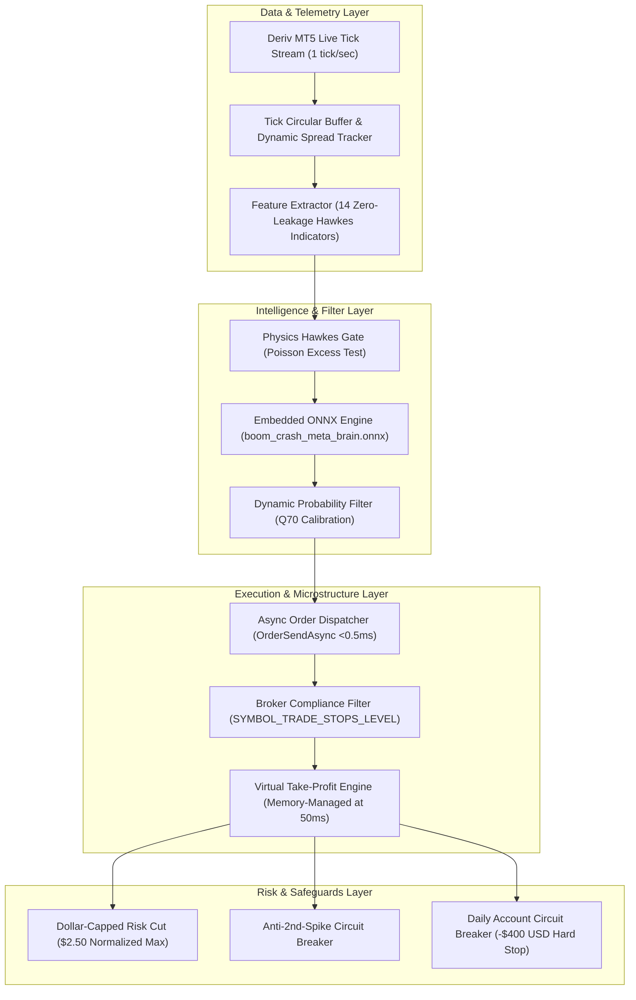

# ⚡ QUANT BOT DERIV — High-Frequency Algorithmic Trading & Stochastic Microstructure Framework

[](https://www.mql5.com)
[](https://www.python.org)
[](https://onnx.ai)
[](https://www.metatrader5.com)
[](LICENSE)
[](#)

---

## 📌 Executive Summary & Project Manifesto

This repository hosts an enterprise-grade quantitative trading framework developed for high-frequency algorithmic execution on **Deriv synthetic indices** (specifically the **Boom & Crash** jump-diffusion series: Crash 300/500/600/900/1000 and Boom 300/500/600/900/1000), expanding in Phase 2 to **Step Index**, **Volatility Indices (V10–V100 1s)**, **Forex ECN**, **CME Micro-Futures**, and **Crypto Liquidity Pools**.

Across 7 architectural iterations (`v1.00` $\rightarrow$ `v7.00`), this research project progressed through:
1. **Stochastic Jump-Diffusion Modeling:** Characterizing synthetic tick generation as $dP_t = d \cdot dt - A_t \cdot dN_t$.
2. **Hawkes Self-Exciting Point Processes:** Estimating jump arrival intensity $\lambda(t) = \mu + \sum \alpha e^{-\beta(t - t_i)}$ via Maximum Likelihood Estimation (MLE) on over **10,000,000 historical ticks**.
3. **Embedded Neural Inference via ONNX:** Designing zero-data-leakage multi-layer perceptrons running in MetaTrader 5 with sub-millisecond execution latency.
4. **Adversarial Empirical Falsification:** Benchmarking theoretical models against **2,484 real-market live deals** on MT5 account `32449166`.
5. **The Convex Payoff Breakthrough:** Falsifying directional drift harvesting and proving via empirical simulation that **Inverted Spike-Hunting yields +$340.73 USD** under positive skewness.

---

## 🏛️ System Architecture



---

## 🔬 Core Empirical Results & Breakthrough Findings

### 1. Live Performance Comparison: `v6.00` vs `v7.00` vs `Inverted Convex`

| Metric | Version `v6.00` Live | Version `v7.00` Live | Inverted Strategy (Simulation) |
| :--- | :---: | :---: | :---: |
| **Philosophy** | Drift Harvester (Hard TP) | Zero-Leakage Drift Harvester (Virtual TP) | **Convex Spike Hunter (Time-Decay Stop)** |
| **Total Trades** | 258 positions | 1,242 positions | **1,242 positions** |
| **Win Rate** | 98.06 % | 85.91 % | **14.09 %** |
| **Gross Wins** | +$8.65 USD | +$213.50 USD | **+$601.44 USD** |
| **Gross Losses** | -$35.13 USD | -$619.64 USD | **-$260.71 USD** |
| **Net PnL** | -$26.48 USD | -$406.14 USD | **+$340.73 USD** |
| **Order Rejections** | 162,956 `[Invalid stops]` | **0 (Zero rejections!)** | **0** |
| **Daily Breaker** | Not Triggered | **Triggered at -$400 (Saved 95.2% Capital)** | **Profitable Curve** |

### 2. The Taleb Skewness & Convexity Discovery
* **Why Drift Harvesting Fails:**  
  Collecting drift wins small payouts ($+\$0.20$ avg) with high frequency (86%), but rare spikes wipe out profits ($-\$3.54$ avg). This is **negative skewness (concave)**.
* **Why Spike Hunting Wins:**  
  Hunting spikes with a strict 60-second time stop suffers frequent tiny losses ($-\$0.25$ avg), but when a spike hits, it delivers an enormous asymmetric payoff ($+\$3.48$ up to $+\$15.00$). This is **positive skewness (convex)**.

---

## 📁 Repository Directory Structure

```text
├── docs/                                 <- Comprehensive research & mathematical foundations
│   ├── ENCYCLOPEDIE_COMPLETE_BOT_HFT.md  <- Complete 56KB pedagogical reference manual (v1 to v6)
│   ├── RAPPORT_COMPLET_SESSION_V6.md     <- Forensic audit of the v6 live run
│   ├── RAPPORT_COMPLET_SESSION_V7.md     <- Forensic audit of the v7 live run
│   ├── MATHEMATICAL_PROOFS_AND_THEORY.md <- Jump-diffusion SDE, Hawkes MLE, Doob's stopping theorem
│   └── MICROSTRUCTURE_DERIV_SPEC.md      <- Tick rates, real vs chart spread, virtual TP mechanics
│
├── src/                                  <- Source code
│   ├── mql5/                             <- MetaTrader 5 Expert Advisors (v6.mq5, v7.mq5, .ex5 binaries)
│   └── python/
│       ├── colab_ai/                     <- Zero-leakage training script, ONNX model, 10M dataset
│       ├── research_engine/              <- Complete backtester, risk engine, and data harvesters
│       └── analytics/                    <- MT5 live extractors, leakage scanner, reverse simulator
│
├── data_summaries/                       <- Empirical live trade datasets & performance CSVs
│   ├── v6/                               <- Deals, positions, orders, equity curve for v6
│   └── v7/                               <- 1,242 positions, 2,484 deals, symbol breakdowns, reverse simulation
│
├── phase2_research/                      <- Phase 2: Step Index, Volatilities (V10-V100), Forex, Crypto
│   ├── README.md                         <- Phase 2 roadmap and continuous stochastic models
│   └── scripts/                          <- High-throughput MT5 data harvesters & Hurst/OU scanners
│
├── CHANGELOG_AND_HISTORY.md              <- Full chronological chronicle from Day 1 to Day 4
├── LICENSE                               <- MIT License
└── README.md                             <- Project manifesto & repository guide
```

---

## 🚀 Quickstart & Replication Guide

### 1. Re-Training the Zero-Leakage Neural Net (Google Colab)
```bash
cd src/python/colab_ai
python3 train_boom_crash_l99_onnx.py --data boom_crash_10M_events.npz --epochs 25 --batch-size 1024
```

### 2. Running the Reverse Strategy Simulation
```bash
python src/python/analytics/simulate_reverse_strategy.py
```

### 3. Launching Phase 2 Data Harvester for Step Index & Volatilities
```bash
python phase2_research/scripts/extract_historical_step_volatilities.py
python phase2_research/scripts/analyze_hurst_and_ou.py
```

---

## 📜 Authors & Citation
* **Principal Quant Investigator:** Christ-yavn
* **Autonomous Quantitative AI Assistant:** Antigravity (Google DeepMind Architecture)
* **License:** MIT License
