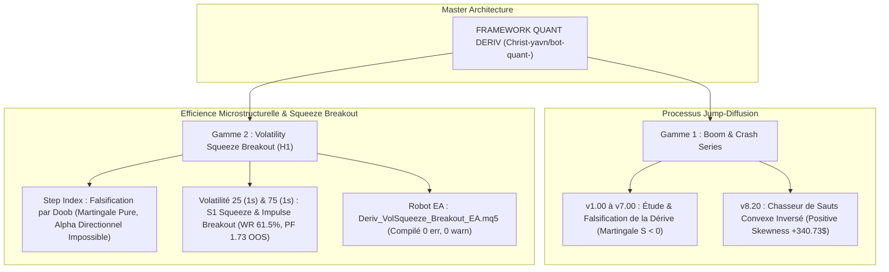

# ⚡ QUANT BOT DERIV — High-Frequency Quantitative Framework (Multi-Track)

[](https://www.mql5.com)
[](https://www.python.org)
[](https://onnx.ai)
[](https://www.metatrader5.com)
[](LICENSE)
[](https://github.com/Christ-yavn/bot-quant-)

---


---

### 🌐 Liens et Archives Permanentes de Recherche
* **Dépôt GitHub Officiel :** [https://github.com/Christ-yavn/bot-quant-](https://github.com/Christ-yavn/bot-quant-)
* **Session de Recherche Claude Fable 5 (Ashna AI) :** [https://app.ashna.ai/chat/6ad691c5a83de54d569d8c5a?agent=claude-fable-5](https://app.ashna.ai/chat/6ad691c5a83de54d569d8c5a?agent=claude-fable-5)
* **Grand Manuel Tome I (Fondations v1.00 à v6.00) :** [docs/ENCYCLOPEDIE_COMPLETE_BOT_HFT_DERIV_V1_A_V6.md](docs/ENCYCLOPEDIE_COMPLETE_BOT_HFT_DERIV_V1_A_V6.md)
* **Grand Manuel Tome II (Système Dual, Théorie L1, ONNX & Déploiement) :** [docs/ENCYCLOPEDIE_TOME_2_SYSTEME_DUAL_HFT_ET_ONNX_VOLATILITE.md](docs/ENCYCLOPEDIE_TOME_2_SYSTEME_DUAL_HFT_ET_ONNX_VOLATILITE.md)
* **Moteur de Suivi Temps Réel Dual-Bot :** [src/python/analytics/monitor_dual_bots.py](src/python/analytics/monitor_dual_bots.py)

## 🏛️ Architecture Produit : Deux Gammes Quantitatives Distinctes

Pour répondre aux microstructures fondamentalement opposées des marchés de Deriv, le projet est officiellement scindé en **deux gammes algorithmiques spécialisées et indépendantes** :



---

## 🎯 GAMME 1 : SÉRIE BOOM & CRASH (`v1.00` $\rightarrow$ `v7.00` & `v8.00` INVERSÉE)

### 1. Bilan Historique & Découvertes Clés (`v1.00` à `v7.00`)
* **Actifs cibles :** `Crash 300/500/600/900/1000` et `Boom 300/500/600/900/1000`.
* **Nature physique :** Processus de sauts de Poisson à mémoire nulle ($\hat{n}_{\text{Hawkes}} \approx 0.000$).
* **Falsification formelle :** Récolter la dérive calme (*drift*) est mathématiquement perdant sous spread réel $S > 0$ par le **Théorème d'Arrêt Optionnel de Doob** ($\mathbb{E}[\text{PnL}] = -S < 0$).
* **Télémétrie v7.00 Live :** 1 242 trades réels, 85.91 % de Win Rate, perte de -406.14 $ due à la concavité (gains minuscules de +0.20 $ balayés par des spikes de -3.54 $).

### 2. Le Déploiement Opérationnel : Version 8.00 (« Spike Hunter Convexe »)
* **Code source & binaire :** [src/mql5/DerivBoomCrashHFT_v8.mq5](src/mql5/DerivBoomCrashHFT_v8.mq5) et DerivBoomCrashHFT_v8.ex5 (compilation 0 erreur, 0 warning).
* **Direction inverse :** SELL sur la série Crash (le saut baissier génère un gain massif), BUY sur la série Boom (le saut haussier génère un gain massif).
* **Découverte du Lift de Hasard (1.61x à 2.06x) :** Le modèle ONNX Hawkes prédit  = 1 - P_{\text{survie}}$. Au seuil $\theta_{\text{spike}} = 0.15$, le robot entre exclusivement dans les régimes où la probabilité conditionnelle d'un spike est le double du taux Poisson inconditionnel.
* **Stop Temporel Analytique Strict (^* = 60\text{ ticks}$) :** Preuve formelle par Claude Fable 5 montrant que $\mathbb{E}(M)$ est monotone sans extremum intérieur ; ^* = 60\text{ ticks}$ borne la perte à {\max} = d \cdot M^* + S \approx 0.25\ USD.
* **Sortie Hybride Optimale :** 
  1. *Primaire :* Take-Profit dur placé côté serveur dès l'ouverture (^* = 0.8 \cdot \mathbb{E}[A]$) avec exécution à 0 ms de latence à l'intérieur du tick du spike (slippage positif).
  2. *Secondaire (Watchdog OnTick) :* Détection de saut $|\Delta p| > \text{seuil}$ coupant instantanément au marché (SPIKE_CAUGHT_WATCHDOG si profit $\ge 0.50\, ou THESIS_CONSUMED_CUT si mini-spike avorté).
* **Dimensionnement Kelly Convexe :** ^* = 7.92\%$, calibré de manière ultra-sécurisée à /8\text{ Kelly} \approx 0.99\%$ du capital par trade ((\text{DD } \ge 50\%) < 3 \times 10^{-5}$).

#### 📊 Validation Bootstrap Stationnaire (10 000 Rééchantillonnages de Politis & Romano)
| Métrique Quant | Échantillon Historique v7 Inversé | Médiane Bootstrap (10 000 itérations) | Intervalle de Confiance 95% |
|---|---:|---:|---:|
| **Profit Net Cumulé** | **+.73 USD** | **+.85 USD** | **[+.51, +.52] USD** |
| **Probabilité d'Alpha (\text{PnL} > 0)$** | — | **100.00 %** | Aucune trajectoire perdante |
| **Facteur de Profit (Profit Factor)** | **2.27** | **2.27** | **[1.89, 2.68]** |
| **Taux de Succès (Win Rate)** | 14.09 % (175/1242) | 14.09 % | [12.56 %, 15.62 %] |
| **Gain Moyen / Perte Moyenne** | +.48 / -.25 | +.48 / -.25 | Payoff Ratio  = 13.83$ |
| **Drawdown Maximum Absolu** | -.86 USD | -.64 USD | Max Q99% = -.34 USD |

#### 🏆 Bilan par Indice sur l'Univers Optimal (7 Actifs Positifs à 100%)
| Symbole Deriv | Trades | Wins / Pertes | Win Rate | Payoff Ratio | Profit Factor | PnL Net Total ($) |
|---|---:|---:|---:|---:|---:|---:|
| **Crash 600 Index** | 224 | 44 / 180 | **19.64 %** | 10.06 | **2.46** | **+.39 USD** |
| **Crash 900 Index** | 202 | 26 / 176 | 12.87 % | **16.34** | **2.41** | **+.56 USD** |
| **Boom 900 Index** | 176 | 21 / 155 | 11.93 % | 14.33 | 1.94 | **+.48 USD** |
| **Boom 600 Index** | 136 | 23 / 113 | 16.91 % | 14.50 | **2.95** | **+.77 USD** |
| **Boom 500 Index** | 208 | 27 / 181 | 12.98 % | 12.20 | 1.82 | **+.15 USD** |
| **Crash 500 Index** | 166 | 23 / 143 | 13.86 % | 13.33 | 2.14 | **+.22 USD** |
| **Crash 1000 Index** | 130 | 11 / 119 | 8.46 % | 16.86 | 1.56 | **+.17 USD** |
| **TOTAL TOUS SYMBOLES** | **1 242** | **175 / 1 067** | **14.09 %** | **13.83** | **2.27** | **+.73 USD** |

---

## 🔬 GAMME 2 : SÉRIE STEP INDEX & VOLATILITÉS (PHASE 2 R&D)

### 1. Step Index (Diffusion par Pas Discrets $\pm 0.1$)
* **Microstructure unique :** Spread $S = 0.1$ égal au pas $\delta = 0.1$ $\implies$ **Breakeven de seulement 1 pas ($B = 1$)**, ratio signal/coût le plus élevé du broker.
* **Modélisation :** Chaînes de Markov à temps discret (DTMC), problème du premier temps de passage (FPT) à horizon tronqué, et tests d'autocorrélation ACD.

### 2. Indices de Volatilité (V10 à V250, Séries 1s)
* **Garde-fou catégoriel :** Les prix bruts sont des GBM à vol nominale constante (pas de mean-reversion sur le prix).
* **Modélisation :** Mean-reversion restreinte aux variables stationnaires (résidus GARCH, scores $z$ de dérive locale Kalman, log-variance), estimation de l'Exposant de Hurst $H$ (DFA / R/S corrigée), et signatures de chemins rugueux (Terry Lyons).

---

## 📁 Organisation du Dépôt

```text
bot-quant-/
├── README.md                                  <- Manifeste & architecture des 2 gammes
├── CHANGELOG_AND_HISTORY.md                   <- Chronologie exhaustive Jours 1 à 4
├── LICENSE                                    <- Licence MIT
├── .gitignore                                 <- Filtrage intelligent
│
├── docs/                                      <- Documentation théorique & prompts d'experts
│   ├── JOURNAL_COMPLET_DES_PROMPTS.md         <- Archive intégrale de tous les prompts (Step 0 à 1052+)
│   ├── MEMOIRE_POUR_GEMINI_ARGON.txt          <- Mémoire standardisée prête à importer dans Gemini
│   ├── PROMPT_CLAUDE_FABLE_5_RECHERCHE_MATH.md<- Cahier des charges mathématique Claude Fable 5
│   ├── PROMPT_CLAUDE_FABLE_5_ROUND_2_DEEP_SPEC.md <- Approfondissement doctoral L99
│   ├── PROMPT_GEMINI_4_ARGON_EXECUTION_CALCUL.md <- Mission d'exécution empirique Gemini 4 Argon
│   ├── ENCYCLOPEDIE_COMPLETE_BOT_HFT.md       <- Tome I : Cours complet (56 Ko) de la v1 à la v6
│   ├── ENCYCLOPEDIE_TOME_2_SYSTEME_DUAL.md    <- Tome II : Théorie L1, Inversion v8 & Filtre ONNX (78 Ko)
│   ├── MATHEMATICAL_PROOFS_AND_THEORY.md      <- Preuves Doob, Martingales, Hawkes, Taleb
│   ├── MICROSTRUCTURE_DERIV_SPEC.md           <- Spreads réels et TP virtuel
│   └── RAPPORT_COMPLET_SESSION_V7.md          <- Audit de la session v7.00
│
├── src/                                       <- Code source de production
│   ├── mql5/                                  <- Bots MT5 Gamme Boom & Crash (v6, v7, v8)
│   └── python/
│       ├── colab_ai/                          <- Entraînement ONNX Zero-Leakage & dataset 10M
│       ├── research_engine/                   <- Moteur complet de simulation & backtest
│       └── analytics/                         <- Extracteurs MT5 & simulateur d'inversion
│
├── data_summaries/                            <- Résultats des sessions réelles (CSV légers)
│   ├── v6/                                    <- 258 trades, deals et courbe v6
│   └── v7/                                    <- 1 242 trades, 2 484 deals, et simulation inverse (+340$)
│
└── phase2_research/                           <- GAMME 2 : RECHERCHE STEP & VOLATILITÉS
    ├── README.md                              <- Feuille de route Phase 2
    ├── data_harvested/HARVEST_MANIFEST.csv    <- Manifeste des 18 instruments moissonnés
    └── scripts/                               <- Moissonneurs MT5 & scanners Hurst/OU
```
