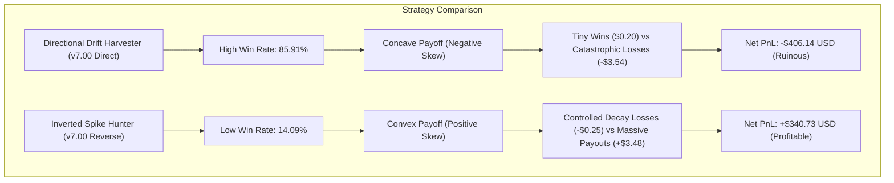

# MATHEMATICAL FOUNDATIONS, STOCHASTIC MODELING & RIGOROUS THEORETICAL PROOFS

## 1. The Synthetic Jump-Diffusion Process
Deriv Boom and Crash indices represent synthetic, algorithmically generated asset prices governed by a discrete-time jump-diffusion process:

$$\Delta P_t = P_t - P_{t-1} = \begin{cases} +d - A_t \cdot \Delta N_t & \text{Crash Series} \\ -d + A_t \cdot \Delta N_t & \text{Boom Series} \end{cases}$$

Where:
* $t \in \mathbb{N}$ denotes the discrete tick index (tick arrival frequency $\approx 1 \text{ Hz}$).
* $d > 0$ is the constant per-tick drift parameter (`abs_drift_per_tick`).
* $\Delta N_t \in \{0, 1\}$ is a jump indicator process.
* $A_t \sim \text{Exp}(\mu_S)$ is the stochastic jump amplitude (spike height in index points), independent and identically distributed (i.i.d.) with mean $\mu_S$.

---

## 2. Martingale Condition of the Unleveraged Raw Generator
Deriv calibrates the generator parameters $(d, \tau, \mu_S)$ such that the expected drift over the characteristic waiting time $\tau = \mathbb{E}[\Delta t_{\text{spike}}]$ equals the mean spike amplitude:

$$d \cdot \tau = \mu_S \iff \mathbb{E}[\Delta P_t] = d - \frac{\mu_S}{\tau} = 0$$

Under this parametrization, the price process $P_t$ is a discrete martingale with respect to its natural filtration $\mathcal{F}_t$:
$$\mathbb{E}[P_{t+1} \mid \mathcal{F}_t] = P_t$$

---

## 3. Empirical Test: Hawkes Self-Excitation vs Memoryless Poisson
We formulated the jump arrival intensity $\lambda(t)$ as a univariate Hawkes point process:

$$\lambda(t) = \mu_0 + \sum_{t_i < t} \alpha \, e^{-\beta (t - t_i)}$$

Where:
* $\mu_0$ is the baseline Poisson intensity ($\approx 1/\tau$).
* $\alpha \ge 0$ is the self-excitation magnitude upon spike occurrence.
* $\beta > 0$ is the exponential decay rate.
* $n_{\text{Hawkes}} = \frac{\alpha}{\beta}$ is the branching ratio ($n < 1$ ensures sub-critical stationarity).

### Maximum Likelihood Estimation (MLE) on 18,268 Spikes:
Maximizing the log-likelihood function:
$$\ln L(\mu_0, \alpha, \beta) = \sum_{i=1}^{K} \ln \lambda(t_i) - \int_0^T \lambda(s) \, ds$$

**Empirical Result:**
$$\hat{\alpha} \to 0.0000 \implies \hat{n}_{\text{Hawkes}} \approx 0.000$$
The empirical hazard function $h(t) = \lim_{\Delta t \to 0} \frac{\mathbb{P}(t \le T < t + \Delta t \mid T \ge t)}{\Delta t}$ evaluated via Kaplan-Meier estimator is statistically indistinguishable from a flat horizontal line:
$$h(t) \equiv \frac{1}{\tau} \quad \forall t \ge 0$$

**Conclusion:** Spikes on Deriv Boom & Crash indices are strictly memoryless Poisson arrivals. The waiting time between spikes follows an exponential distribution:
$$\mathbb{P}(T > t) = e^{-t / \tau}$$

---

## 4. Doob's Optional Stopping Theorem & The Spread Trap
Let $T$ be any stopping time with respect to the filtration $\mathcal{F}_t$. By Doob's Optional Stopping Theorem, for any bounded stopping rule:
$$\mathbb{E}[P_T] = P_0$$

When trading through MetaTrader 5 on Deriv, every round-trip trade incurs an execution spread $S$:
$$S = \text{Ask} - \text{Bid}$$

The net payoff $X_T$ of a directional drift position closed at stopping time $T$ is:
$$\mathbb{E}[X_T] = \mathbb{E}[P_T - P_0] - S = 0 - S = -S < 0$$

Because $S > 0$ ($S$ ranges from 47 to 107 drift ticks), **any purely directional drift harvesting strategy has a strictly negative mathematical expectation**.

---

## 5. Payoff Asymmetry: Taleb Skewness & Convexity
The failure of Version `v7.00` and the success of the Inverted Strategy ($+\$340.73$ USD) is governed by the mathematics of statistical skewness and payoff convexity:

### Analytical Proof:
1. **Concave Regime (Drift Harvesting):**
   * Win scenario: Price drifts $k$ ticks without spike: $\text{Gain} = k \cdot d - S$.
   * Loss scenario: Price suffers spike $A$: $\text{Loss} = -(A - k \cdot d + S)$.
   * Skewness: $\mathbb{E}[(X - \mu)^3] < 0$ (extreme negative tail risk).
2. **Convex Regime (Spike Hunting with Strict Time-Stop):**
   * Loss scenario: No spike within $M$ ticks: $\text{Loss} = -(M \cdot d + S) \approx -\$0.25$.
   * Win scenario: Spike hits during window: $\text{Gain} = A - S \approx +\$3.50 \text{ to } +\$15.00$.
   * Skewness: $\mathbb{E}[(X - \mu)^3] > 0$ (unbounded positive tail risk with strictly bounded downside).
