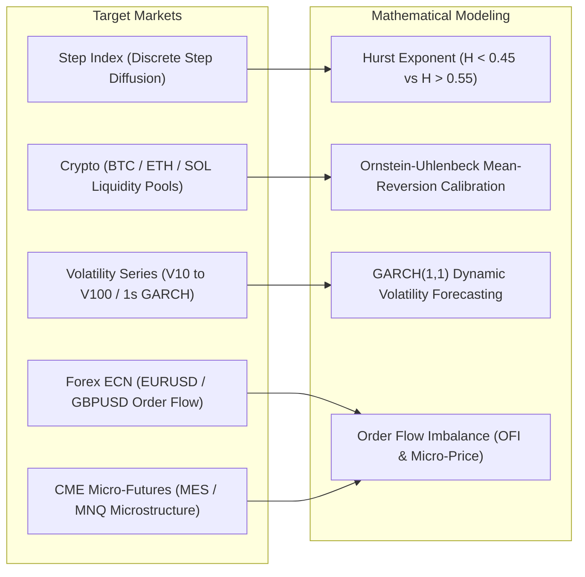

# PHASE 2: CONTINUOUS SYNTHETIC INDICES & MULTI-ASSET QUANT RESEARCH

## 1. Scope & Research Objective
Phase 1 focused rigorously on **Boom & Crash** jump-diffusion synthetic indices.  
Phase 2 broadens the horizon to assets with **continuous volatility regimes**, starting with **Deriv Step Index** and **Volatility Indices (V10 to V100 1s)**, followed by genuine financial assets (**Forex ECN**, **CME Micro-Futures**, and **Crypto Liquidity Pools**).

---

## 2. Asset Universe Matrix

---

## 3. Quantitative Models Under Investigation

### A. Step Index (Discrete Threshold Diffusion)
* **Mechanics:** Steps up or down by fixed increments (+0.1 / -0.1) with probabilistic memory.
* **Mathematical Focus:** Absorbing Markov chains and discrete first-passage time (FPT) probability distributions.

### B. Volatility Indices (Continuous Stochastic Volatility)
* **Mechanics:** Continuous Brownian motion with constant or fluctuating variance (Heston model / GARCH(1,1)):
  $$dS_t = \mu S_t dt + \sqrt{V_t} S_t dW_t^{(1)}$$
  $$dV_t = \kappa (\bar{V} - V_t) dt + \xi \sqrt{V_t} dW_t^{(2)}$$
* **Strategy Archetype:** Mean-reverting statistical arbitrage, volatility band mean-reversion (Bollinger/Keltner via Kalman filter), and high-frequency momentum breaks.

### C. Real Financial Assets (Microstructure & Order Book)
* **ECN Forex & Futures:** Bid-Ask bounce, Level 2 order flow imbalance (OFI), volume-synchronized probability of toxicity (VPIN).
