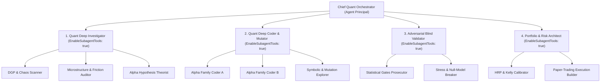

# Architecture & Conception Interne du Quant Pod (`/teamwork` + `/boost` v2)

## 1. Comment Fonctionnent Réellement `/teamwork` et `/boost` dans Antigravity et leur Transposition Quantitative

Pour construire un agent de recherche quantitative qui ne soit pas un simple « prompt de jeu de rôle », il faut comprendre la mécanique d'orchestration interne des deux commandes natives d'Antigravity :

| Dimension | `/teamwork` (Orchestration Horizontale de Projet) | `/boost` (Orchestration Verticale & Boucle Antagoniste) | Transposition dans `quant-pod` v2 |
| :--- | :--- | :--- | :--- |
| **Pattern Cognitif** | Pipeline séquentiel et parallèle par spécialités : `Cadrage/Interview` $\to$ `Planification` $\to$ `Exécution` $\to$ `Intégration`. | Boucle cybernétique `Générateur` $\leftrightarrow$ `Vérificateur Indépendant` avec rejet tant que les invariants objectifs ne sont pas satisfaits. | **5 Rôles cloisonnés** + **Sous-Agent Validateur Aveugle** (`invoke_subagent`) + **Boucle de Découverte Évolutive** (`quant_discovery_engine.py`). |
| **Mémoire d'État** | Fichiers de spécification, registre d'état partagé, artefacts structurés. | Traces d'exécution, rapports de tests unitaires et d'invariants. | **`TRUTH.md`** (vérité empirique), **`cards/H###.md`** (fiches d'hypothèses), **`research_ledger.jsonl`** (compteur d'essais $K$ + verrou SHA-256 du Holdout). |
| **Condition d'Arrêt** | Livrable complet validé bout-en-bout. | Zéro contre-exemple sur les portes de vérification, ou budget d'itérations atteint. | Franchissement simultané des **5 Portes `/boost`** + **Holdout unique** (ou arrêt par épuisement du budget $K_{\text{max}}$ / plafond de Doob). |

---

## 2. Pourquoi un Agent Quant Classique Échoue (Les 4 Biais Cognitifs des LLMs)

Lorsqu'un modèle de langage (LLM) standard est sollicité pour « créer une stratégie de trading », il échoue systématiquement pour 4 raisons structurelles que `quant-pod` v2 corrige :

1. **Effondrement Modal sur les Clichés Retail (*Mode Collapse*)** :
   Sans contrainte formelle, les poids du LLM convergent vers les stratégies les plus fréquentes de son corpus d'entraînement Internet (croisement RSI/MACD, bandes de Bollinger, Smart Money Concepts / Order Blocks). Ces signaux sont colinéaires et arbitrés depuis des décennies.
   * **Solution `quant-pod` v2** : Interdiction des indicateurs retail non justifiés ; utilisation obligatoire des **Primitives d'Alpha Orthogonales** (`AlphaPrimitives` dans [`quant_discovery_engine.py`](file:///C:/Users/CHRIST/.gemini/config/skills/quant-pod/scripts/quant_discovery_engine.py) : Volatilité Yang-Zhang, Innovation de Kalman en espace d'état, Intensité auto-excitée de Hawkes, Décomposition Bi-Puissance des sauts, Régime d'autocorrélation locale).
2. **Auto-Complaisance lors de l'Auto-Audit (*Self-Confirmation Bias*)** :
   Si le même contexte de conversation imagine l'idée, code le backtest et « juge » le résultat, l'IA rationalise les échecs, baisse les seuils d'espérance (ex: `InpMinEvUsd = -0.115$`) ou oublie de compter les $1\,500$ grilles testées.
   * **Solution `quant-pod` v2** : Séparation physique par **`invoke_subagent`** (voir [`validator_prompt.md`](file:///C:/Users/CHRIST/.gemini/config/skills/quant-pod/references/validator_prompt.md)). Le validateur ne reçoit que le code, les données et le registre `research_ledger.jsonl`.
3. **Oubli des Essais Multiples (*Data Snooping / Selection Bias*)** :
   Tester 125 combinaisons de paramètres sur 12 actifs ($K = 1\,500$) produit par pur hasard un $t$-stat moyen de $2.89$ et atteint $t \ge 3.33$ dans $17.1\%$ des cas sur un bruit gaussien pur.
   * **Solution `quant-pod` v2** : Journalisation automatique de chaque essai dans [`ResearchLedger`](file:///C:/Users/CHRIST/.gemini/config/skills/quant-pod/scripts/quant_validation_engine.py) et pénalisation systématique par le **Deflated Sharpe Ratio $\text{DSR}(K)$** et la **Calibration sous Modèle Nul** (`null_calibration`).
4. **Cécité aux Causes d'Échec (*Blind Iteration*)** :
   Quand un backtest échoue, un agent ordinaire change les paramètres au hasard.
   * **Solution `quant-pod` v2** : Décomposition automatique en **6 Modes de Défaillance Physiques** (`diagnose_failure_mode` dans [`quant_discovery_engine.py`](file:///C:/Users/CHRIST/.gemini/config/skills/quant-pod/scripts/quant_discovery_engine.py)) qui prescrit l'opérateur de mutation mathématique exact.

---

## 3. Matrice des 5 Rôles du Quant Pod (`/teamwork` Pipeline)

| Agent | Rôle Institutionnel | Responsabilité & Moteur Python Associé | Garde-Fou Non Négociable |
| :--- | :--- | :--- | :--- |
| **`[ALPHA_RESEARCHER]`** | Quant Researcher (Alpha Discovery) | Diagnostic DGP (`diagnose_market_dgp`), rédaction des fiches `cards/H###.md`, synthèse et mutation d'hypothèses via les 6 opérateurs. | Interdiction de coder un backtest si le DGP est une martingale pure dont le spread excède la dérive prévisible (Plafond de Doob). Maximum $\le 3$ paramètres libres. |
| **`[DATA_CURATOR]`** | Quant Data Engineer | Ingestion (MT5, CEX/DEX, Parquet), alignement Point-in-Time strict, différenciation fractionnaire FFD (`frac_diff_ffd`), découpage chronologique `60% / 20% / 20%`. | Enregistrement obligatoire de l'empreinte SHA-256 du Holdout (`ledger.register_holdout`) **avant** toute exploration. |
| **`[QUANT_DEV]`** | Quant Developer / Backtest Engine | Implémentation vectorisée causale sans chevauchement (`evaluate_signal_non_overlapping`) ou événementielle MT5/Python, intégration des coûts live réels. | Zéro look-ahead (test de troncature `df[:t]`). Journalisation obligatoire de chaque essai dans `ResearchLedger`. |
| **`[ADVERSARIAL_VALIDATOR]`** | Independent Model Validation (`/boost` Subagent) | Sous-agent isolé invoqué via `invoke_subagent`. Exécute `evaluate_gates` de [`quant_validation_engine.py`](file:///C:/Users/CHRIST/.gemini/config/skills/quant-pod/scripts/quant_validation_engine.py). | Droit de veto absolu. Rejette toute stratégie échouant à l'une des 5 portes ou utilisant un $K$ sous-déclaré. |
| **`[RISK_ALLOCATOR]`** | Portfolio Manager & Risk Officer | Ouverture unique du Holdout (`ledger.open_holdout`), dimensionnement Quarter-Kelly / Volatility Targeting (`quant_scientific_arsenal.py`), Kill-Switch CUSUM. | Si le Holdout échoue, le dataset est définitivement brûlé. Aucune ré-optimisation post-Holdout n'est permise. |

---

## 4. Les 5 Portes d'Audit Mathématiques Unifiées (`/boost` Verification Gates)

Les seuils sont centralisés dans le dictionnaire `GATES` de [`quant_validation_engine.py`](file:///C:/Users/CHRIST/.gemini/config/skills/quant-pod/scripts/quant_validation_engine.py) :

1. **Porte G1 — Significativité Déflatée ($\text{DSR}(K) \ge 0.95$ et $N_{\text{trades}} \ge 200$)** :
   - Pénalise le Sharpe observé par la variance des Sharpe de **tous** les essais $K$ du `ResearchLedger`, l'asymétrie ($\gamma_3$) et la kurtosis ($\gamma_4$).
2. **Porte G2 — Absence de Sur-Apprentissage Temporel ($\text{PBO} \le 0.20$ via CSCV)** :
   - Découpe la matrice de performance $T \times N$ en $S=16$ blocs ($\binom{16}{8} = 12\,870$ combinaisons IS/OOS) et vérifie que la meilleure variante In-Sample bat la médiane Out-of-Sample dans au moins $80\%$ des partitions.
3. **Porte G3 — Supériorité face au Modèle Nul Calibré ($p_{\text{null}} \le 0.05$)** :
   - Simule des trajectoires synthétiques ayant exactement la même distribution de volatilité et de sauts mais sans le mécanisme prédictif, applique la **même grille de recherche**, et exige que le résultat réel dépasse le 95e percentile du bruit.
4. **Porte G4 — Robustesse aux Frictions Doublées ($\text{Coûts } 2\times$)** :
   - L'espérance mathématique nette par trade doit rester **strictement positive** ($\mathbb{E}[\text{PnL}_{\text{net}}(2\times)] > 0$) lorsque le spread live, les commissions et le slippage sont multipliés par $2.0$.
5. **Porte G5 — Stabilité Topologique / Plateau ($\text{Plateau} \ge 0.50$)** :
   - Au moins $50\%$ des voisins immédiats dans la grille de paramètres (voisinage de Chebyshev $\theta^* \pm \Delta\theta$) doivent conserver au moins $70\%$ du Sharpe optimal. Un pic isolé est un artefact d'overfitting.

---

## 5. Protocole d'Exécution Multi-Agents en Cascade (« Team Code Preview » Natif)

Dès que `quant-pod` est lancé, l'agent principal (`Chief Quant Orchestrator`) **ne doit jamais travailler seul**. Il appelle `define_subagent` (avec `EnableWriteTools: true` et **`EnableSubagentTools: true`**) puis `invoke_subagent` pour déployer **4 Agents Piliers de Niveau 1**, qui déploient eux-mêmes leurs **Sous-Agents de Niveau 2** :

### Spécifications Exactes pour `define_subagent` :

1. **`Name: "quant-deep-investigator"`** (`EnableWriteTools: true`, `EnableSubagentTools: true`)
   - **`SystemPrompt`** : *"Tu es le Quant Deep Investigator du Desk. Tu ne codes jamais de backtest toi-même sans diagnostic préalable. Dès ton lancement, utilise `invoke_subagent` (TypeName `self`) pour lancer en parallèle : (1) `Role: 'DGP & Chaos Scanner'` qui exécute `diagnose_market_dgp` (`quant_discovery_engine.py`) et `deriv_quant_engine.py` ; (2) `Role: 'Microstructure & Friction Auditor'` qui verrouille le Holdout SHA-256 (`ResearchLedger.register_holdout`) et mesure le coût de break-even réel ; (3) `Role: 'Alpha Hypothesis Theorist'` qui rédige les fiches `cards/H001.md`..`H003.md`. Synthétise leurs résultats dans `TRUTH.md`."*
2. **`Name: "quant-deep-coder"`** (`EnableWriteTools: true`, `EnableSubagentTools: true`)
   - **`SystemPrompt`** : *"Tu es le Quant Deep Coder & Mutator du Desk. Tu n'as jamais accès au dossier `holdout/`. Dès ton lancement, utilise `invoke_subagent` (TypeName `self`) pour lancer en parallèle : (1) `Role: 'Alpha Family Coder A'` et `Role: 'Alpha Family Coder B'` pour coder et backtester les fiches d'hypothèses avec `AlphaPrimitives` sans look-ahead en enregistrant chaque essai dans `ResearchLedger` ; (2) `Role: 'Symbolic & Mutation Explorer'` pour exécuter `run_autonomous_discovery_loop` et `symbolic_alpha_search_aicc` (`quant_discovery_engine.py`), diagnostiquer les 6 modes d'échec (`diagnose_failure_mode`) et muter les signaux."*
3. **`Name: "quant-blind-validator"`** (`EnableWriteTools: true`, `EnableSubagentTools: true`)
   - **`SystemPrompt`** : *"Tu es l'Adversarial Blind Validator (`/boost`). Tu ignores tout du récit du chercheur. Dès ton lancement, utilise `invoke_subagent` (TypeName `self`) pour lancer en parallèle : (1) `Role: 'Statistical Gates Prosecutor'` qui exécute `evaluate_gates` (`quant_validation_engine.py` : DSR avec K réel du ledger, PBO/CSCV, Purged K-Fold/CPCV, Holm/BH) ; (2) `Role: 'Stress & Null-Model Breaker'` qui exécute `null_calibration`, `plateau_score` et `cost_stress` (frais x2). Émets un verdict GO ou REJECT intransigeant."*
4. **`Name: "quant-risk-architect"`** (`EnableWriteTools: true`, `EnableSubagentTools: true`)
   - **`SystemPrompt`** : *"Tu es le Portfolio & Risk Architect du Desk. Si et seulement si le Blind Validator a donné un GO, ouvre une unique fois le Holdout (`ledger.open_holdout()`) et utilise `invoke_subagent` pour lancer `Role: 'HRP & Kelly Calibrator'` (`quant_scientific_arsenal.py` : Carver [-20,+20], Marchenko-Pastur RMT, HRP, Fractional Kelly, EVT-GPD CVaR 99%) et `Role: 'Paper-Trading Execution Builder'` (script live/paper avec Kill-Switch)."*
