# Architecture & Conception Interne du Quant Pod (`/teamwork` + `/boost` v3.0)

## 1. Comment Fonctionnent Réellement `/teamwork` et `/boost` dans Antigravity et leur Transposition Quantitative

Pour construire un agent de recherche quantitative qui ne soit pas un simple « prompt de jeu de rôle », il faut comprendre la mécanique d'orchestration interne des deux commandes natives d'Antigravity :

| Dimension | `/teamwork` (Orchestration Horizontale de Projet) | `/boost` (Orchestration Verticale & Boucle Antagoniste) | Transposition dans `quant-pod` v3.0 |
| :--- | :--- | :--- | :--- |
| **Pattern Cognitif** | Pipeline séquentiel et parallèle par spécialités : `Cadrage/Interview` $\to$ `Planification` $\to$ `Exécution` $\to$ `Intégration`. | Boucle cybernétique `Générateur` $\leftrightarrow$ `Vérificateur Indépendant` avec rejet tant que les invariants objectifs ne sont pas satisfaits. | **5 Rôles Fondateurs** + **Comité Senior & 4 Piliers** (`invoke_subagent`) + **Boucle de Découverte Évolutive** (`quant_discovery_engine.py`). |
| **Mémoire d'État** | Fichiers de spécification, registre d'état partagé, artefacts structurés. | Traces d'exécution, rapports de tests unitaires et d'invariants. | **`TRUTH.md`** (vérité empirique), **`cards/H###.md`** (fiches d'hypothèses), **`ledger_chain.jsonl`** (compteur d'essais $K$ + verrou SHA-256 du Holdout). |
| **Condition d'Arrêt** | Livrable complet validé bout-en-bout. | Zéro contre-exemple sur les portes de vérification, ou budget d'itérations atteint. | Franchissement simultané des **10 Portes `/boost`** (`G0`–`G8`) + **Holdout unique** (ou arrêt par épuisement du budget $K_{\text{max}}$ / plafond de Doob). |

---

## 2. Pourquoi un Agent Quant Classique Échoue (Les 4 Biais Cognitifs des LLMs)

Lorsqu'un modèle de langage (LLM) standard est sollicité pour « créer une stratégie de trading », il échoue systématiquement pour 4 raisons structurelles que `quant-pod` v3.0 corrige :

1. **Effondrement Modal sur les Clichés Retail (*Mode Collapse*)** :
   Sans contrainte formelle, les poids du LLM convergent vers les stratégies les plus fréquentes de son corpus d'entraînement Internet (croisement RSI/MACD, bandes de Bollinger, Smart Money Concepts / Order Blocks). Ces signaux sont colinéaires et arbitrés depuis des décennies.
   * **Solution `quant-pod` v3.0** : Interdiction des indicateurs retail non justifiés ; utilisation obligatoire des **Primitives d'Alpha Orthogonales** (`AlphaPrimitives` dans [`quant_discovery_engine.py`](../scripts/quant_discovery_engine.py) : Volatilité Yang-Zhang, Innovation de Kalman en espace d'état, Intensité auto-excitée de Hawkes, Décomposition Bi-Puissance des sauts, Régime d'autocorrélation locale).
2. **Auto-Complaisance lors de l'Auto-Audit (*Self-Confirmation Bias*)** :
   Si le même contexte de conversation imagine l'idée, code le backtest et « juge » le résultat, l'IA rationalise les échecs, baisse les seuils d'espérance (ex: `InpMinEvUsd = -0.115$`) ou oublie de compter les $1\,500$ grilles testées.
   * **Solution `quant-pod` v3.0** : Séparation physique par **`invoke_subagent`** (voir [`validator_prompt.md`](./validator_prompt.md)). Le validateur ne reçoit que le code, les données et le registre `ledger_chain.jsonl`.
3. **Oubli des Essais Multiples (*Data Snooping / Selection Bias*)** :
   Tester 125 combinaisons de paramètres sur 12 actifs ($K = 1\,500$) produit par pur hasard un $t$-stat moyen de $2.89$ et atteint $t \ge 3.33$ dans $17.1\%$ des cas sur un bruit gaussien pur.
   * **Solution `quant-pod` v3.0** : Journalisation automatique de chaque essai dans [`ResearchLedger`](../scripts/quant_validation_engine.py) / [`HashChainLedger`](../scripts/research_integrity.py) et pénalisation systématique par le **Deflated Sharpe Ratio $\text{DSR}(N_{\text{eff}})$** et la **Calibration sous Modèle Nul** (`null_calibration`).
4. **Cécité aux Causes d'Échec (*Blind Iteration*)** :
   Quand un backtest échoue, un agent ordinaire change les paramètres au hasard.
   * **Solution `quant-pod` v3.0** : Décomposition automatique en **6 Modes de Défaillance Physiques** (`diagnose_failure_mode` dans [`quant_discovery_engine.py`](../scripts/quant_discovery_engine.py)) qui prescrit l'opérateur de mutation mathématique exact.

---

## 3. Hiérarchie Complète du Desk Institutionnel (Du Senior CIO jusqu'aux Membres Spécialistes & Juniors)

`quant-pod` v3.0 conserve intégralement les **5 Rôles Fondateurs** (`[ALPHA_RESEARCHER]`, `[DATA_CURATOR]`, `[QUANT_DEV]`, `[ADVERSARIAL_VALIDATOR]`, `[RISK_ALLOCATOR]`) ainsi que les **4 Agents Piliers de Niveau 1** et étend l'organigramme pour reproduire un véritable desk quantitatif multi-stratégies :

### A. Comité Exécutif Senior & Gouvernance Indépendante (Niveau Direction & Board)
| Poste Senior | Titre Institutionnel | Responsabilité & Algorithme Associé | Droit de Veto / Invariant |
| :--- | :--- | :--- | :--- |
| **`[CIO_ORCHESTRATOR]`** | Managing Director / CIO, Head of Quantitative Trading & Chief Quant Strategist | Cadrage de la campagne, allocation du budget $K_{\max}$, scellement initial du Holdout SHA-256 (`seal_holdout`), arbitrage final d'allocation du livre (`TRUTH.md`). | Interdit tout monologue solo ; impose la séparation stricte entre recherche, codage et validation. |
| **`[STRATEGY_PLANNER]`** | Chief Market Regime & Macro-Micro Strategist / Algorithmic Strategy Planner | Diagnostic du régime DGP (`diagnose_market_dgp` : `MOMENTUM_PERSISTENT`, `MEAN_REVERTING`, `REGIME_SWITCHING_CHAMELEON` par variance d'ACF locale + parité spectrale, `MARTINGALE_PURE_SANS_MEMOIRE`) et génération du plan stratégique (`AlgorithmicStrategyPlanner` / `plan_strategy_from_market_regime`). | Veto de Doob immédiat si le marché est une martingale pure sans mémoire ($\mathbb{E}[\text{PnL}] = -\text{Coûts}$). Prescrit l'horizon optimal $H^*$ et les priors de familles avant tout backtest. |
| **`[PRINCIPAL_EXECUTION_QUANT]`** | Principal Execution & Microstructure Quant | Modélisation exacte des frictions live (spread exécuté, impact d'Almgren-Chriss, sélection adverse `markouts`, LVR Uniswap v3, liquidation CEX Perp), validation de la chronologie intra-barre de `backtest_events` (`SL_GAP`, stops dès la barre d'entrée, `bar_returns` mark-to-market causaux) et du tampon de rotation de Gârleanu-Pedersen. | Rejette tout backtest ignorant le spread live, la latence $\ge 1$ barre ou lissant linéairement les rendements intra-trade. |
| **`[GOVERNANCE_CUSTODIAN]`** | Independent Board : Null-Model & PRNG Auditor + Cryptographic Holdout Custodian | Vérification de la chaîne SHA-256 (`HashChainLedger.verify()` / `ResearchLedger.verify()`), arbre de Merkle (`data_manifest`), audit CSPRNG NIST SP 800-22/90B et autorisation d'ouverture unique du Holdout. | Bloque toute ré-optimisation post-Holdout et toute suppression d'essai perdant dans le registre. |

### B. Matrice des 5 Rôles Historiques du Pod & Membres Seniors / Juniors Associés (`/teamwork` Pipeline)

| Agent | Rôle Institutionnel | Responsabilité & Moteur Python Associé | Garde-Fou Non Négociable |
| :--- | :--- | :--- | :--- |
| **`[ALPHA_RESEARCHER]`** | Senior Quant Researcher & Lead Hypothesis Theorist (`quant-deep-investigator`) | Diagnostic DGP (`diagnose_market_dgp`), planification (`AlgorithmicStrategyPlanner`), rédaction des fiches `cards/H###.md`, régularisation syntaxique AST (`ast_originality_penalty`), débat contradictoire (`bull_bear_hypothesis_debate`) et mutation via les 6 opérateurs. | Interdiction de coder un backtest si le DGP est une martingale pure dont le spread excède la dérive prévisible (Plafond de Doob). Maximum $\le 3$ paramètres libres. |
| **`[DATA_CURATOR]`** | Principal Microstructure Quant & Junior PIT Data Curator (`quant-deep-investigator`) | Ingestion (MT5, CEX/DEX, Parquet), alignement Point-in-Time strict (`asof_join_point_in_time`), différenciation fractionnaire FFD (`frac_diff_ffd`), audit LVR/funding (`crypto_defi_engine.py`), découpage chronologique `60% / 20% / 20%`. | Enregistrement obligatoire de l'empreinte SHA-256 du Holdout (`seal_holdout` / `register_holdout`) **avant** toute exploration. |
| **`[QUANT_DEV]`** | Principal Signal Architect, Bandit Mutator & Junior QA Backtest Engineer (`quant-deep-coder`) | Implémentation causale vectorisée $O(N)$ (`AlphaPrimitives`, `H5_Chameleon_Kalman_Regime`), ordonnanceur `UCBFamilyBandit`, découpage causal Train/Validation (70 % / 30 %) pour les mutations, simulation événementielle `backtest_events` (chronologie intra-barre exacte + `bar_returns`). | Zéro look-ahead (`lookahead_truncation_test == False`). Journalisation obligatoire de chaque essai dans `ResearchLedger` / `HashChainLedger`. |
| **`[ADVERSARIAL_VALIDATOR]`** | Head of Independent Model Validation, Econometric Prosecutor & Junior Forensic Auditor (`quant-blind-validator`) | Sous-agent isolé invoqué via `invoke_subagent`. Exécute `evaluate_gates` (`quant_validation_engine.py`), `hansen_spa`, `romano_wolf_stepm`, `model_confidence_set`, `deflated_sharpe_effective` ($N_{\text{eff}}$ + `null_var_cap`) et `null_models.py`. | Droit de veto absolu. Rejette toute stratégie échouant à l'une des portes `/boost` ou utilisant un $K$ sous-déclaré. |
| **`[RISK_ALLOCATOR]`** | Chief Portfolio Manager, Execution Builder & Junior Desk Risk Monitor (`quant-risk-architect`) | Ouverture unique du Holdout (`open_holdout`), test de spanning d'alpha orthogonal (`orthogonal_alpha_spanning_test` Newey-West HAC), allocation multi-régimes (`regime_conditional_book_allocator` RMT + HRP + tampon Gârleanu-Pedersen + CVaR 99 % EVT-GPD), Kill-Switch CUSUM. | Si le Holdout échoue, le dataset est définitivement brûlé. Aucune ré-optimisation post-Holdout n'est permise. |

---

## 4. Les 10 Portes d'Audit Mathématiques Unifiées (`/boost` Verification Gates `G0`–`G8`)

Les seuils officiels sont centralisés dans le dictionnaire `GATES` de [`quant_validation_engine.py`](../scripts/quant_validation_engine.py) et complétés par [`quant_inference_engine.py`](../scripts/quant_inference_engine.py) :

1. **Porte G0 & G0.bis — Taille d'Échantillon ($N_{\text{trades}} \ge 200$, `MinTRL`) & Anti-Lookahead (`0` discordance)** :
   - Interdiction de conclure sous $200$ trades (`GATES["min_trades"]`) ou sous `min_track_record_length` ajusté du skew/kurtosis ; `lookahead_truncation_test` strictement nul.
2. **Porte G1 — Significativité Déflatée ($\text{DSR}(N_{\text{eff}}) \ge 0.95$ et $t_{\text{net}} \ge 3.0$)** :
   - Pénalise le Sharpe observé par la variance bornée (`null_var_cap`) des Sharpe de **tous** les essais $K$ du `ResearchLedger` (échelle commensurable) ou $N_{\text{eff}}$ spectral, l'asymétrie ($\gamma_3$) et la kurtosis ($\gamma_4$).
3. **Porte G2 — Hansen SPA & Romano-Wolf StepM ($p_{\text{SPA}} \le 0.05$)** :
   - Stationary Bootstrap à longueur de bloc automatique Politis-White-Patton préservant le clustering GARCH et contrôlant le FWER.
4. **Porte G3 — Supériorité face au Modèle Nul Calibré ($p_{\text{null}} \le 0.05$)** :
   - Simule $M \ge 100$ trajectoires synthétiques sans edge (`null_models.py`), applique la **même grille de recherche**, et exige que le résultat réel dépasse le 95e percentile du bruit.
5. **Porte G4 — Absence de Sur-Apprentissage Temporel ($\text{PBO} \le 0.20$ via CSCV & MCS)** :
   - Découpe la matrice de performance $T \times N$ en blocs symétriques CSCV et vérifie que la meilleure variante In-Sample bat la médiane Out-of-Sample dans au moins $80\%$ des partitions (`GATES["pbo_max"] = 0.20`).
6. **Porte G5 — Stabilité Topologique / Plateau ($\text{Plateau} \ge 0.50$)** :
   - Au moins $50\%$ des voisins immédiats dans la grille de paramètres (distance de Chebyshev 1) doivent rester $> 0$ et conserver au moins $50\%$ de la métrique optimale (`plateau_score` $\ge 0.50$). Un pic isolé est un artefact d'overfitting.
7. **Porte G6 — Robustesse aux Frictions Doublées ($\text{Coûts } 2\times$ & Markouts)** :
   - L'espérance mathématique nette par trade doit rester **strictement positive** ($\mathbb{E}[\text{PnL}_{\text{net}}(2\times)] > 0$) lorsque le spread live, les commissions et le slippage sont multipliés par $2.0$.
8. **Porte G7 & G8 — Intégrité Cryptographique SHA-256 (`ledger.verify()["valid"] == True`), Décroissance OOS ($\le 0.50$) & Spanning Orthogonal ($t_{\text{HAC}} \ge 1.96$)** :
   - Vérifie qu'aucun essai n'a été effacé (`HashChainLedger`), que la décroissance OOS reste $\le 50\%$, et que l'alpha ajouté au livre existant survit à `orthogonal_alpha_spanning_test`.

---

## 5. Protocole d'Exécution Multi-Agents en Cascade (« Team Code Preview » Natif)

Dès que `quant-pod` est lancé, l'agent principal (`Chief Quant Orchestrator / CIO & Managing Director`, épaulé par le `Chief Market Regime & Algorithmic Strategy Planner`, le `Principal Execution & Microstructure Quant` et l'`Independent Governance & Holdout Custodian`) **ne doit jamais travailler seul**. Il appelle `define_subagent` (avec `EnableWriteTools: true` et **`EnableSubagentTools: true`**) puis `invoke_subagent` pour déployer **4 Agents Piliers de Niveau 1**, qui déploient eux-mêmes leurs **Membres Spécialistes & Juniors de Niveau 2** :

```mermaid
flowchart TD
    O["Comité Exécutif Senior : CIO Orchestrator • Algorithmic Strategy Planner • Principal Execution Quant • Holdout Custodian"]
    O --> I["1. Quant Deep Investigator (EnableSubagentTools: true)"]
    O --> C["2. Quant Deep Coder & Mutator (EnableSubagentTools: true)"]
    O --> V["3. Adversarial Blind Validator (EnableSubagentTools: true)"]
    O --> R["4. Portfolio & Risk Architect (EnableSubagentTools: true)"]

    I --> I1["DGP, Chaos & PRNG Forensics Scanner"]
    I --> I2["Microstructure, DEX & Friction Auditor"]
    I --> I3["Bull-vs-Bear Hypothesis Theorist"]
    I --> I4["Junior Data & Point-in-Time Curator"]

    C --> C1["Alpha Family Coder A (State-Space & Chameleon)"]
    C --> C2["Alpha Family Coder B (Microstructure & DeFi)"]
    C --> C3["AST Symbolic & Bandit Mutator"]
    C --> C4["Junior Backtest & QA Execution Engineer"]

    V --> V1["Econometric SPA & Multiple-Testing Prosecutor"]
    V --> V2["Null-Model & Friction Breaker"]
    V --> V3["Junior Replication & Forensic Code Auditor"]

    R --> R1["HRP, Spanning & Kelly Calibrator"]
    R --> R2["Paper-Trading & Live Execution Builder"]
    R --> R3["Junior Desk Risk & Kill-Switch Monitor"]
```

### Spécifications Exactes pour `define_subagent` :

1. **`Name: "quant-deep-investigator"`** (`EnableWriteTools: true`, `EnableSubagentTools: true`)
   - **`SystemPrompt`** : *"Tu es le Quant Deep Investigator du Desk (`[ALPHA_RESEARCHER]` & `[DATA_CURATOR]`). Tu ne codes jamais de backtest toi-même sans diagnostic préalable. Dès ton lancement, utilise `invoke_subagent` (TypeName `self`) pour lancer en parallèle : (1) `Role: 'DGP, Chaos & PRNG Forensics Scanner'` qui exécute `diagnose_market_dgp` + `plan_strategy_from_market_regime` (`AlgorithmicStrategyPlanner` dans `quant_discovery_engine.py`), `prng_forensics.py` et `deriv_quant_engine.py` ; (2) `Role: 'Microstructure, DEX & Friction Auditor'` qui verrouille le Holdout SHA-256 (`seal_holdout` / `ResearchLedger.register_holdout`) et mesure le coût de break-even réel (`crypto_defi_engine.py`) ; (3) `Role: 'Bull-vs-Bear Hypothesis Theorist'` qui rédige `cards/H001.md`..`H005.md`, filtre via `ast_originality_penalty`, exécute `bull_bear_hypothesis_debate` et scelle `commit_hypothesis` ; (4) `Role: 'Junior Data & Point-in-Time Curator'` qui applique `asof_join_point_in_time`, `frac_diff_ffd` et `data_manifest`. Synthétise leurs résultats dans `TRUTH.md`."*
2. **`Name: "quant-deep-coder"`** (`EnableWriteTools: true`, `EnableSubagentTools: true`)
   - **`SystemPrompt`** : *"Tu es le Quant Deep Coder & Mutator du Desk (`[QUANT_DEV]`). Tu n'as jamais accès au dossier `holdout/`. Dès ton lancement, utilise `invoke_subagent` (TypeName `self`) pour lancer en parallèle : (1) `Role: 'Alpha Family Coder A'` et `Role: 'Alpha Family Coder B'` pour coder et backtester les fiches d'hypothèses avec `AlphaPrimitives` (incluant `H5_Chameleon_Kalman_Regime`), vérifier `lookahead_truncation_test` = `OK` et simuler via `backtest_events` (chronologie intra-barre exacte + `bar_returns` mark-to-market causaux) ; (2) `Role: 'AST Symbolic & Bandit Mutator'` pour exécuter `UCBFamilyBandit` (initialisé avec `StrategyPlan.family_priors`), `run_autonomous_discovery_loop` (avec découpage causal Train 70% / Validation 30%) et `symbolic_alpha_search_aicc`, et journaliser chaque essai dans `ResearchLedger` / `HashChainLedger` ; (3) `Role: 'Junior Backtest & QA Execution Engineer'` pour auditer la grille temporelle `bar_returns` et l'exécution pessimiste des stops."*
3. **`Name: "quant-blind-validator"`** (`EnableWriteTools: true`, `EnableSubagentTools: true`)
   - **`SystemPrompt`** : *"Tu es l'Adversarial Blind Validator (`/boost`, `[ADVERSARIAL_VALIDATOR]`). Tu ignores tout du récit du chercheur. Dès ton lancement, utilise `invoke_subagent` (TypeName `self`) pour lancer en parallèle : (1) `Role: 'Econometric SPA & Multiple-Testing Prosecutor'` qui exécute `evaluate_gates` (`quant_validation_engine.py` : seuils `GATES` unifiés) et `quant_inference_engine.py` (`hansen_spa`, `romano_wolf_stepm`, `model_confidence_set`, `deflated_sharpe_effective` avec `null_var_cap`) ; (2) `Role: 'Null-Model & Friction Breaker'` qui exécute `null_models.py` ($M \ge 100$), `plateau_score` et `cost_stress` (frais x2) ; (3) `Role: 'Junior Replication & Forensic Code Auditor'` qui recompte $K$ et vérifie `ledger.verify()['valid'] == True`. Émets un verdict GO ou REJECT intransigeant."*
4. **`Name: "quant-risk-architect"`** (`EnableWriteTools: true`, `EnableSubagentTools: true`)
   - **`SystemPrompt`** : *"Tu es le Portfolio & Risk Architect du Desk (`[RISK_ALLOCATOR]`). Si et seulement si le Blind Validator a donné un GO, vérifie `ledger.verify()`, ouvre une unique fois le Holdout (`open_holdout`) et utilise `invoke_subagent` pour lancer : (1) `Role: 'HRP, Spanning & Kelly Calibrator'` (`quant_scientific_arsenal.py` : `orthogonal_alpha_spanning_test` Newey-West HAC, `regime_conditional_book_allocator` RMT + HRP + Gârleanu-Pedersen + CVaR 99% EVT-GPD, Carver [-20,+20], Fractional Kelly ¼) ; (2) `Role: 'Paper-Trading & Live Execution Builder'` ; et (3) `Role: 'Junior Desk Risk & Kill-Switch Monitor'` (surveillance CUSUM/SPRT et Kill-Switch automatique)."*
