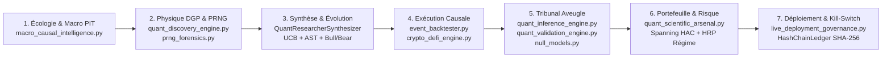

# Le Cerveau du Quant Researcher & Quant Dev Institutionnel : Intelligence Économique, Découverte Causale & Déploiement (`quant-pod` v4.0)

Ce guide méthodologique formalise **comment un véritable Desk Quantitatif (Quant Researcher + Macro Strategist + Quant Dev + Risk Architect)** réfléchit, enquête sur l'économie réelle d'un marché, déniche des stratégies inédites et les industrialise de bout en bout.

---

## 1. La Différence Fondamentale entre un « Tweaker d'Indicateurs » et un Vrai Quant Researcher

Un amateur télécharge des bougies OHLCV et teste au hasard des combinaisons `RSI / MACD / Bollinger / SMC`.
Un **Quant Researcher institutionnel** part d'une loi économique universelle :

> **Loi de Conservation du PnL Net** : Pour qu'une stratégie gagne durablement de l'argent après frais, **quelqu'un d'autre dans l'écosystème doit accepter de perdre cet argent** (parce qu'il couvre un risque commercial, rééquilibre passivement à heure fixe, subit un appel de marge/liquidation, ou transfère une prime de risque macroéconomique).

Avant d'écrire la moindre ligne de signal, le desk exécute donc **4 questions d'enquête structurelle** (`scripts/macro_causal_intelligence.py` + recherche documentaire vérifiée) :

1. **Qui sont les acteurs dominants et contraints de ce marché ?** (`diagnose_market_ecology`)
   - * Hedgers commerciaux / producteurs* (matières premières, énergie, taux) ;
   - *Fonds passifs / ETF à levier / trésoreries multinationales* (fixings Londres 16h00 UTC, clôtures cash 16h00 EST, rebalancements de fin de mois) ;
   - *Spéculateurs retail sur-levierisés* (funding rate perpétuel CEX, cascades de liquidations forcées, options 0DTE) ;
   - *Fournisseurs de liquidité passifs AMM* (Loss-Versus-Rebalancing sur Uniswap v3/v4) ;
   - *Ou aucun acteur humain* (serveur CSPRNG sur indices synthétiques $\implies$ seules les lois stochastiques programmées ou un mispricing d'option comptent).
2. **Quelles forces macro-économiques et quels actifs leaders pilotent ce marché ?** (`classify_macro_liquidity_regime` & `cross_asset_causal_network`)
   - Taux réels et attentes de banques centrales (`US2Y`, `SOFR`, `DXY`), pente des courbes à terme, impulsion de liquidité globale, flux ETF/Stablecoins, structure par terme de volatilité (`Contango` vs `Backwardation`).
   - Séparation stricte entre **corrélation fallacieuse** (facteur commun instantané) et **causalité prédictive retardée** par *Partialing-Out Double-ML* (Chernozhukov et al., 2018) et erreurs standards Newey-West HAC sous contrôle FDR Benjamini-Hochberg.
3. **Quels catalyseurs calendaires et publications économiques créent des chocs récurrents ?** (`pit_macro_release_aligner` & `macro_event_study_analyzer`)
   - Annonces CPI, NFP, FOMC, décisions BCE/BoJ, expirations trimestrielles d'options, rolls de contrats Futures, unlocks de tokens.
   - **Règle d'Or Point-in-Time (Vintage)** : Une statistique économique du mois $M$ n'existe dans le marché qu'à son `release_timestamp` exact — jamais à `reference_ts` !
4. **Quel est le budget de friction face à l'amplitude du mouvement ?** (`diagnose_market_dgp` & `estimate_strategy_capacity_usd`)
   - Si le mouvement conditionnel attendu est de $+4\text{ bps}$ et que le spread + slippage coûte $6\text{ bps}$, la thèse économique est vraie mais l'exécution Taker est morte : il faut allonger l'horizon $H^*$ ou passer en exécution passive Maker.

---

## 2. Protocole Cognitif de Découverte de Nouvelles Stratégies (Intégration des Meilleures Méthodes Cognitives)

Pour empêcher l'IA de retomber dans les clichés retail (*Mode Collapse*), `quant-pod` v4.0 combine **5 protocoles formels** :

### A. L'Échelle Causale de Pearl (2009)
1. **Niveau 1 — Association** : $\mathbb{P}(R_{t+H} \mid X_t)$ — Corrélation brute (insuffisante seule, souvent instable hors-échantillon).
2. **Niveau 2 — Mécanisme & Orthogonalisation** : Après neutralisation de l'auto-corrélation propre et des facteurs confondants $W_t$ (`cross_asset_causal_network`), le choc de $X_{t-\ell}$ conserve-t-il un pouvoir prédictif significatif ($t_{\text{HAC}} \ge 2.0$, $q_{\text{BH}} \le 0.05$) ?
3. **Niveau 3 — Invalidation Contrefactuelle** : *« Que se passerait-il si la contrepartie forcée disparaissait ou si le spread doublait ? »* Testé par `null_models.py` ($M \ge 100$ mondes contrefactuels sans edge) et `cost_stress(mult=2.0)`.

### B. Génération Divergente `VS-Extreme` + Boucle `Actor-Critic` (Zhang et al., ICLR 2026)
Lors de la Phase 2 d'idéation, le `Bull-vs-Bear Hypothesis Theorist` ne propose jamais une seule idée évidente :
- **Acteur (`VS-Extreme`)** : Génère **5 thèses structurelles radicalement distinctes** en échantillonnant hors des sentiers battus (ex: *Spillover taux $\to$ devise/crypto*, *Asymétrie pré/post-fixing*, *Épuisement post-liquidation conditionné au funding*, *Compression Yang-Zhang + accélération d'Open Interest*, *Pente de structure par terme*). Chaque thèse porte une probabilité de typicité $< 0.15$ et est filtrée par **`ast_originality_penalty`** (*AlphaAgent* KDD'25).
- **Critique (`Red Team` / `bull_bear_hypothesis_debate`)** : Attaque chaque thèse sur 4 angles mortels (Plafond de Doob, ratio Coût/Volatilité, risque de queue / liquidation, look-ahead de publication macro) avant d'autoriser le moindre backtest.

### C. Résolution des Contradictions Quantitatives par `TRIZ-40` (Altshuller)
Lorsqu'une stratégie prometteuse échoue sur un compromis physique (`diagnose_failure_mode`), le chercheur applique les principes inventifs TRIZ au lieu d'abandonner ou de suroptimiser :
- **Contradiction « Réactivité vs Faux Signaux »** $\implies$ *Principe #4 (Asymétrie)* : Entrée rapide sur franchissement de choc confirmé par volume/flux, sortie lente gouvernée par le retour à l'équilibre du filtre de Kalman 1D.
- **Contradiction « Horizon Court (peu de risque macro) vs Coûts de Spread Élevés »** $\implies$ *Principe #24 (Intermédiaire)* & *Principe #15 (Dynamisme)* : N'entrer que lorsque la compression de volatilité cède simultanément à une impulsion d'un leader inter-marchés (`build_causal_spillover_forecast`), ou basculer en ordres limites passifs (`plan_child_order_schedule`).
- **Contradiction « Momentum vs Mean-Reversion selon l'époque »** $\implies$ *Principe #35 (Changement d'état)* : Opérateur `Chameleon` conditionné au signe et à l'amplitude de l'autocorrélation glissante locale ou du quadrant macro (`classify_macro_liquidity_regime`).

### D. Vérification Factuelle `CoVe` + `RARR` & Calibration d'Incertitude (Dhuliawala 2023, Kadavath 2022)
Toute affirmation économique ou institutionnelle issue d'une recherche documentaire ou web (horaires de règlement, formule de funding d'un exchange, calendrier FOMC, frais Maker/Taker, tokenomics) doit :
1. Faire l'objet d'une question de vérification indépendante (*Chain-of-Verification*) ;
2. Citer sa source primaire et sa date ;
3. Porter un marqueur explicite d'épistémologie : `[MESURÉ: script -> fichier]`, `[SOURCE PRIMAIRE: url/doc, date]`, `[CONFIANCE: X%]` ou `[HYPOTHÈSE À TESTER]`.

---

## 3. De l'Analyse au Déploiement : Chaîne Complète des 12 Moteurs (`v4.0`)

